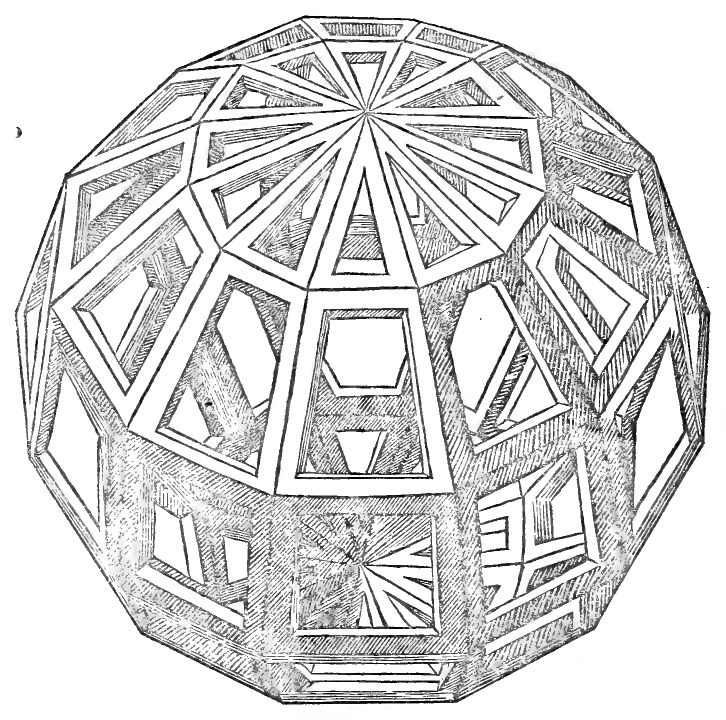

:layout: book
:canonical_id: Tabula XL
:folio: 0269

.. _plates-polyhedra-plate_40-la:

Tabula XL (Folio 0269) — Septuaginta Duarum Basium Vacuum
=========================================================

.. rubric:: Figura Geometrica per Manum Leonardi Vincii (1509)

.. folio:: 0269

   :term:`*Septuaginta Duarum Basium Vacuum* <septuaginta-duarum-basium>` (:term:`Ἑβδομηκονταδισσάεδρον <septuaginta-duarum-basium>` :term:`κενόν <vacuum>`)
