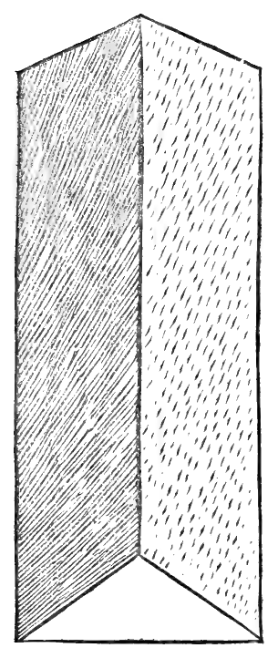

:layout: book
:canonical_id: Plate XLI
:folio: 0271

.. _plates-polyhedra-plate_41:
.. _plates-polyhedra-plate_41-en:

Plate XLI (Folio 0271) — Solid Triangular Prism (Corpus Seratile)
=================================================================

.. rubric:: Perspective Woodcut by Leonardo da Vinci (1509)

.. folio:: 0271

   **Solid Triangular Prism (Corpus Seratile)** — :term:`*Columna Laterata Triangula Solida* <corpo-seratile>` (:term:`Κίων πλευρώδης τρίγωνος <corpo-seratile>` στερεός)
