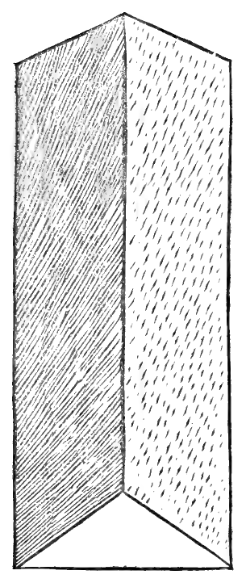

:layout: book
:canonical_id: Tabula XLI
:folio: 0271

.. _plates-polyhedra-plate_41-la:

Tabula XLI (Folio 0271) — Columna Laterata Triangula Solida
===========================================================

.. rubric:: Figura Geometrica per Manum Leonardi Vincii (1509)

.. folio:: 0271

   :term:`*Columna Laterata Triangula Solida* <corpo-seratile>` (:term:`Κίων πλευρώδης τρίγωνος <corpo-seratile>` στερεός)
