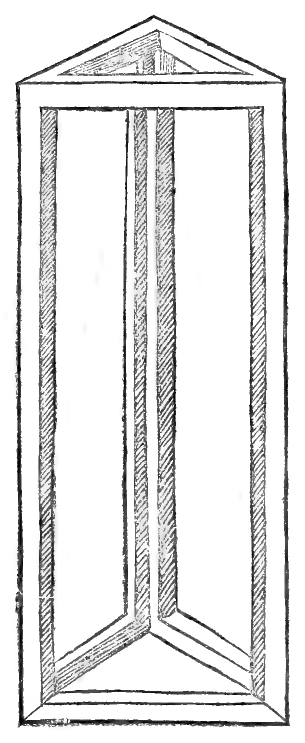

:layout: book
:canonical_id: Plate XLII
:folio: 0273

.. _plates-polyhedra-plate_42:
.. _plates-polyhedra-plate_42-en:

Plate XLII (Folio 0273) — Hollow Triangular Prism
=================================================

.. rubric:: Perspective Woodcut by Leonardo da Vinci (1509)

.. folio:: 0273

   **Hollow Triangular Prism** — :term:`*Columna Laterata Triangula Vacua* <corpo-seratile>` (:term:`Κίων πλευρώδης τρίγωνος <corpo-seratile>` κενός)
