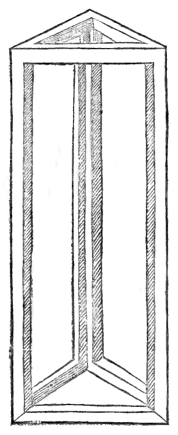

:layout: book
:canonical_id: Tabula XLII
:folio: 0273

.. _plates-polyhedra-plate_42-la:

Tabula XLII (Folio 0273) — Columna Laterata Triangula Vacua
===========================================================

.. rubric:: Figura Geometrica per Manum Leonardi Vincii (1509)

.. folio:: 0273

   :term:`*Columna Laterata Triangula Vacua* <corpo-seratile>` (:term:`Κίων πλευρώδης τρίγωνος <corpo-seratile>` κενός)
