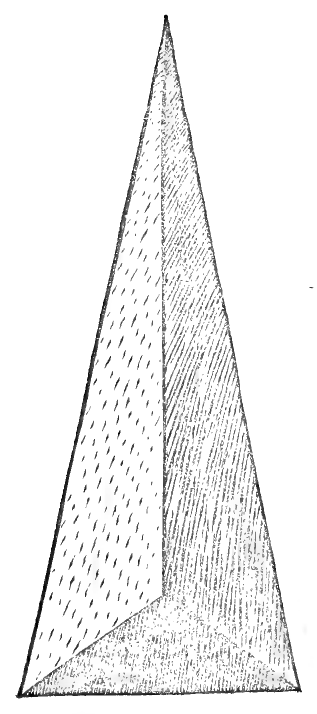

:layout: book
:canonical_id: Plate XLIII
:folio: 0275

.. _plates-polyhedra-plate_43:
.. _plates-polyhedra-plate_43-en:

Plate XLIII (Folio 0275) — Solid Triangular Pyramid
===================================================

.. rubric:: Perspective Woodcut by Leonardo da Vinci (1509)

.. folio:: 0275

   **Solid Triangular Pyramid** — :term:`*Pyramis Laterata Triangula Solida* <pyramide-triangula>` (:term:`Πυραμὶς πλευρώδης τρίγωνος <pyramide-triangula>` στερεά)
