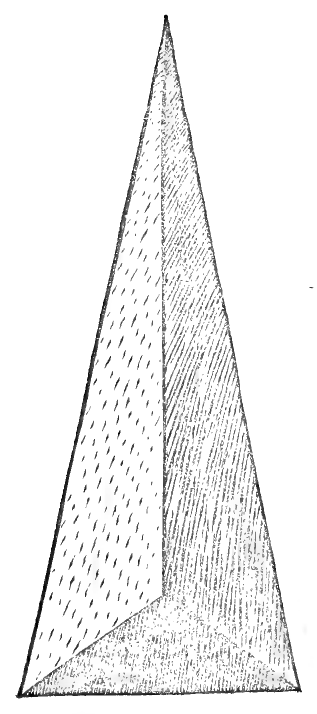

:layout: book
:canonical_id: Tabula XLIII
:folio: 0275

.. _plates-polyhedra-plate_43-la:

Tabula XLIII (Folio 0275) — Pyramis Laterata Triangula Solida
=============================================================

.. rubric:: Figura Geometrica per Manum Leonardi Vincii (1509)

.. folio:: 0275

   :term:`*Pyramis Laterata Triangula Solida* <pyramide-triangula>` (:term:`Πυραμὶς πλευρώδης τρίγωνος <pyramide-triangula>` στερεά)
