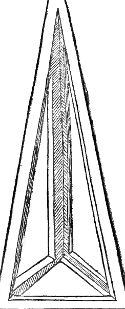

:layout: book
:canonical_id: Plate XLIIII
:folio: 0277

.. _plates-polyhedra-plate_44:
.. _plates-polyhedra-plate_44-en:

Plate XLIIII (Folio 0277) — Hollow Triangular Pyramid
=====================================================

.. rubric:: Perspective Woodcut by Leonardo da Vinci (1509)

.. folio:: 0277

   **Hollow Triangular Pyramid** — :term:`*Pyramis Laterata Triangula Vacua* <pyramide-triangula>` (:term:`Πυραμὶς πλευρώδης τρίγωνος <pyramide-triangula>` κενή)
