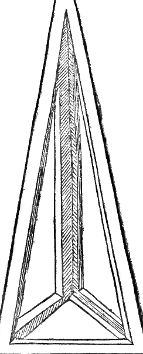

:layout: book
:canonical_id: Tabula XLIIII
:folio: 0277

.. _plates-polyhedra-plate_44-la:

Tabula XLIIII (Folio 0277) — Pyramis Laterata Triangula Vacua
=============================================================

.. rubric:: Figura Geometrica per Manum Leonardi Vincii (1509)

.. folio:: 0277

   :term:`*Pyramis Laterata Triangula Vacua* <pyramide-triangula>` (:term:`Πυραμὶς πλευρώδης τρίγωνος <pyramide-triangula>` κενή)
