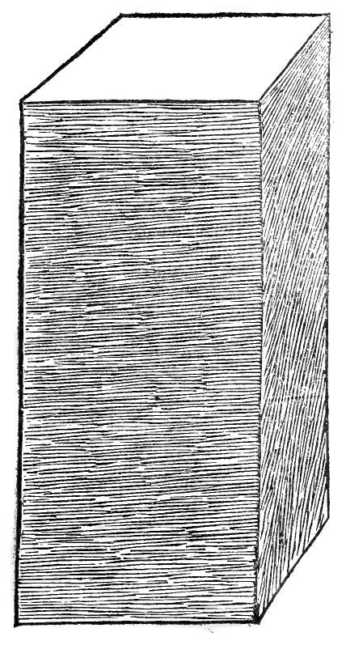

:layout: book
:canonical_id: Plate XLV
:folio: 0279

.. _plates-polyhedra-plate_45:
.. _plates-polyhedra-plate_45-en:

Plate XLV (Folio 0279) — Solid Quadrangular Prism
=================================================

.. rubric:: Perspective Woodcut by Leonardo da Vinci (1509)

.. folio:: 0279

   **Solid Quadrangular Prism** — *Columna Laterata Quadrangula Solida* (Κίων πλευρώδης τετράγωνος στερεός)
