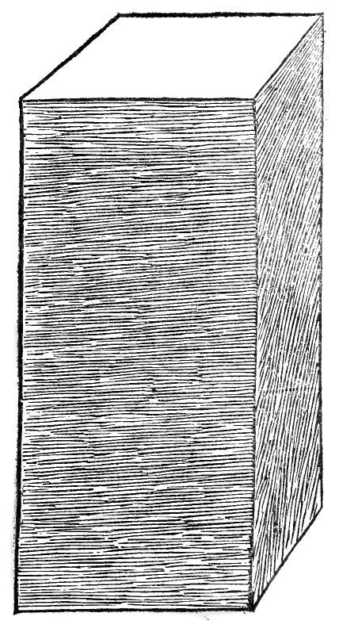

:layout: book
:canonical_id: Tabula XLV
:folio: 0279

.. _plates-polyhedra-plate_45-la:

Tabula XLV (Folio 0279) — Columna Laterata Quadrangula Solida
=============================================================

.. rubric:: Figura Geometrica per Manum Leonardi Vincii (1509)

.. folio:: 0279

   *Columna Laterata Quadrangula Solida* (Κίων πλευρώδης τετράγωνος στερεός)
