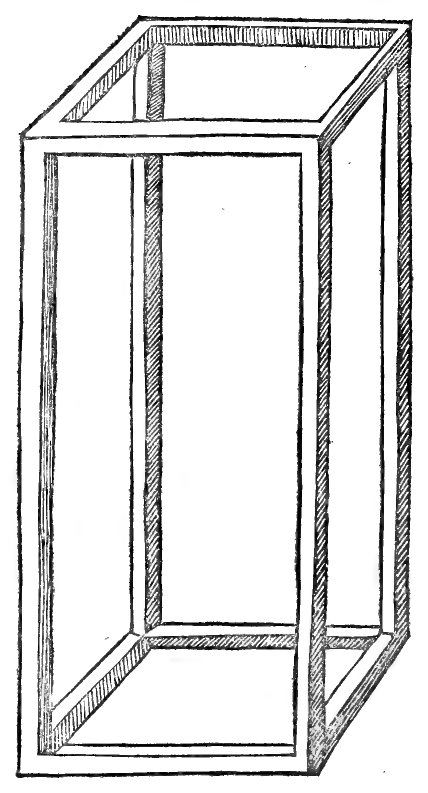

:layout: book
:canonical_id: Plate XLVI
:folio: 0281

.. _plates-polyhedra-plate_46:
.. _plates-polyhedra-plate_46-en:

Plate XLVI (Folio 0281) — Hollow Quadrangular Prism
===================================================

.. rubric:: Perspective Woodcut by Leonardo da Vinci (1509)

.. folio:: 0281

   **Hollow Quadrangular Prism** — *Columna Laterata Quadrangula Vacua* (Κίων πλευρώδης τετράγωνος κενός)
