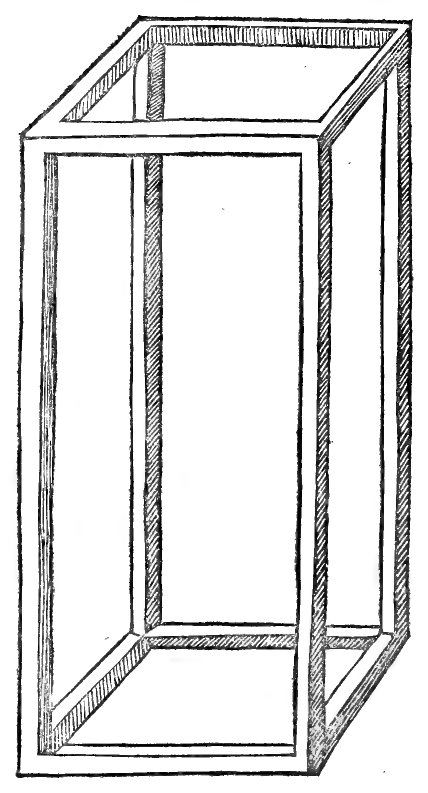

:layout: book
:canonical_id: Tabula XLVI
:folio: 0281

.. _plates-polyhedra-plate_46-la:

Tabula XLVI (Folio 0281) — Columna Laterata Quadrangula Vacua
=============================================================

.. rubric:: Figura Geometrica per Manum Leonardi Vincii (1509)

.. folio:: 0281

   *Columna Laterata Quadrangula Vacua* (Κίων πλευρώδης τετράγωνος κενός)
