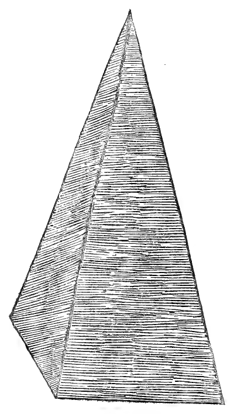

:layout: book
:canonical_id: Plate XLVII
:folio: 0283

.. _plates-polyhedra-plate_47:
.. _plates-polyhedra-plate_47-en:

Plate XLVII (Folio 0283) — Solid Quadrangular Pyramid
=====================================================

.. rubric:: Perspective Woodcut by Leonardo da Vinci (1509)

.. folio:: 0283

   **Solid Quadrangular Pyramid** — *Pyramis Laterata Quadrangula Solida* (Πυραμὶς πλευρώδης τετράγωνος στερεά)
