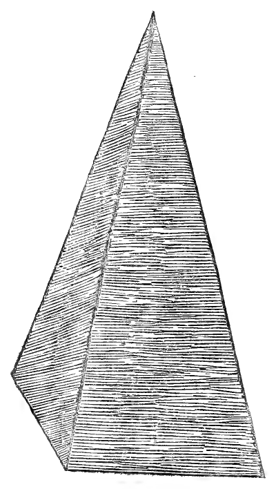

:layout: book
:canonical_id: Tabula XLVII
:folio: 0283

.. _plates-polyhedra-plate_47-la:

Tabula XLVII (Folio 0283) — Pyramis Laterata Quadrangula Solida
===============================================================

.. rubric:: Figura Geometrica per Manum Leonardi Vincii (1509)

.. folio:: 0283

   *Pyramis Laterata Quadrangula Solida* (Πυραμὶς πλευρώδης τετράγωνος στερεά)
