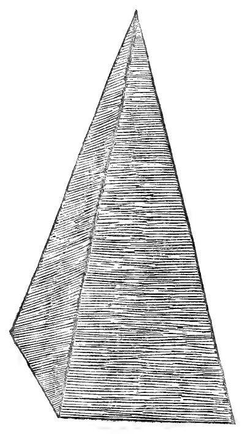

:layout: book
:canonical_id: Plate XLVII
:folio: 0285

.. _plates-polyhedra-plate_48:
.. _plates-polyhedra-plate_48-en:

Plate XLVII-bis (Folio 0285) — Solid Quadrangular Pyramid (Duplicate Scan in Witness)
=====================================================================================

.. rubric:: Perspective Woodcut by Leonardo da Vinci (1509)

.. folio:: 0285

   **Solid Quadrangular Pyramid (Duplicate Scan in Witness)** — *Pyramis Laterata Quadrangula Solida (bis)* (Πυραμὶς πλευρώδης τετράγωνος στερεά)
