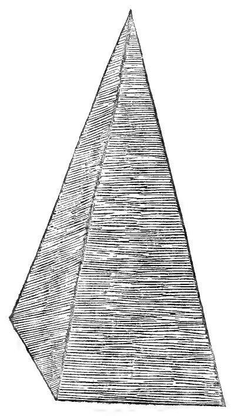

:layout: book
:canonical_id: Tabula XLVII
:folio: 0285

.. _plates-polyhedra-plate_48-la:

Tabula XLVII-bis (Folio 0285) — Pyramis Laterata Quadrangula Solida (bis)
=========================================================================

.. rubric:: Figura Geometrica per Manum Leonardi Vincii (1509)

.. folio:: 0285

   *Pyramis Laterata Quadrangula Solida (bis)* (Πυραμὶς πλευρώδης τετράγωνος στερεά)
