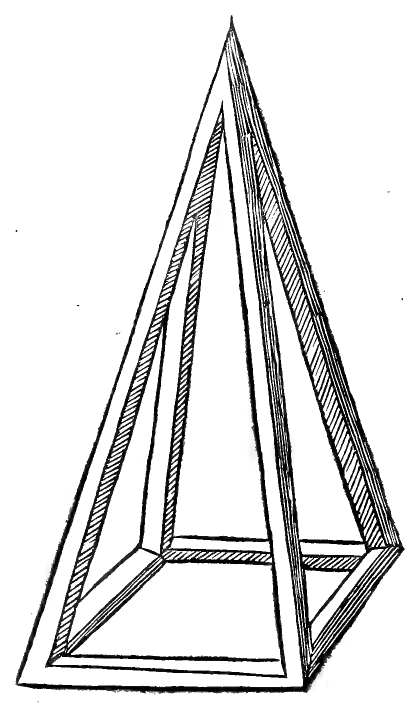

:layout: book
:canonical_id: Plate XLVIII
:folio: 0287

.. _plates-polyhedra-plate_49:
.. _plates-polyhedra-plate_49-en:

Plate XLVIII (Folio 0287) — Hollow Quadrangular Pyramid
=======================================================

.. rubric:: Perspective Woodcut by Leonardo da Vinci (1509)

.. folio:: 0287

   **Hollow Quadrangular Pyramid** — *Pyramis Laterata Quadrangula Vacua* (Πυραμὶς πλευρώδης τετράγωνος κενή)
