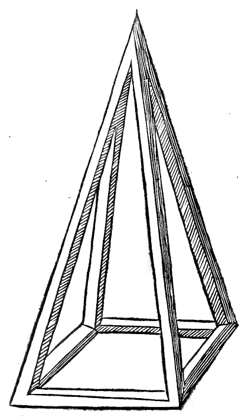

:layout: book
:canonical_id: Tabula XLVIII
:folio: 0287

.. _plates-polyhedra-plate_49-la:

Tabula XLVIII (Folio 0287) — Pyramis Laterata Quadrangula Vacua
===============================================================

.. rubric:: Figura Geometrica per Manum Leonardi Vincii (1509)

.. folio:: 0287

   *Pyramis Laterata Quadrangula Vacua* (Πυραμὶς πλευρώδης τετράγωνος κενή)
