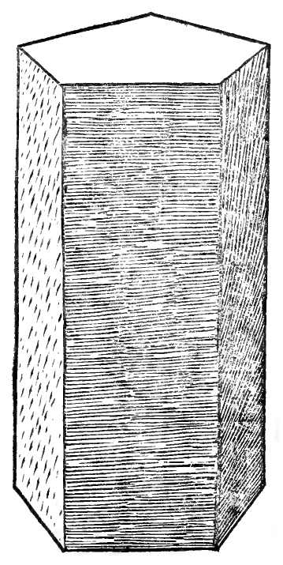

:layout: book
:canonical_id: Plate XLIX
:folio: 0289

.. _plates-polyhedra-plate_50:
.. _plates-polyhedra-plate_50-en:

Plate XLIX (Folio 0289) — Solid Pentagonal Prism
================================================

.. rubric:: Perspective Woodcut by Leonardo da Vinci (1509)

.. folio:: 0289

   **Solid Pentagonal Prism** — *Columna Laterata Penthagona Solida* (:term:`Κίων πλευρώδης πεντάγωνος <colonna-pentagona>` στερεός)
