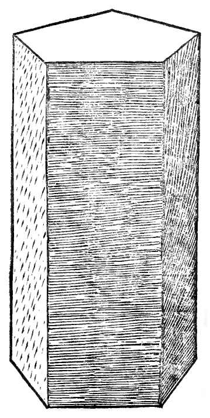

:layout: book
:canonical_id: Tabula XLIX
:folio: 0289

.. _plates-polyhedra-plate_50-la:

Tabula XLIX (Folio 0289) — Columna Laterata Penthagona Solida
=============================================================

.. rubric:: Figura Geometrica per Manum Leonardi Vincii (1509)

.. folio:: 0289

   *Columna Laterata Penthagona Solida* (:term:`Κίων πλευρώδης πεντάγωνος <colonna-pentagona>` στερεός)
