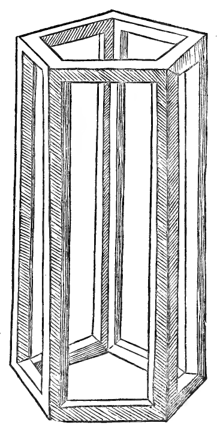

:layout: book
:canonical_id: Plate L
:folio: 0291

.. _plates-polyhedra-plate_51:
.. _plates-polyhedra-plate_51-en:

Plate L (Folio 0291) — Hollow Pentagonal Prism
==============================================

.. rubric:: Perspective Woodcut by Leonardo da Vinci (1509)

.. folio:: 0291

   **Hollow Pentagonal Prism** — *Columna Laterata Penthagona Vacua* (:term:`Κίων πλευρώδης πεντάγωνος <colonna-pentagona>` κενός)
