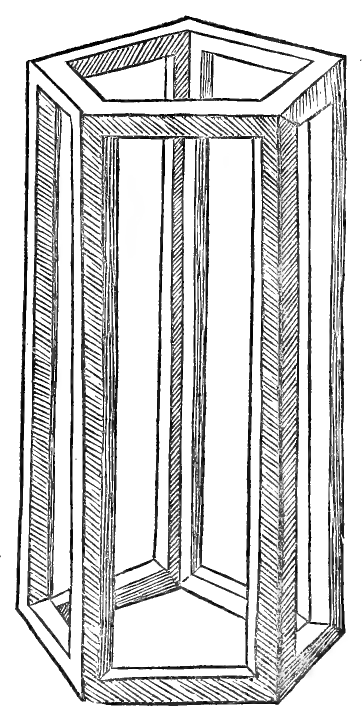

:layout: book
:canonical_id: Tabula L
:folio: 0291

.. _plates-polyhedra-plate_51-la:

Tabula L (Folio 0291) — Columna Laterata Penthagona Vacua
=========================================================

.. rubric:: Figura Geometrica per Manum Leonardi Vincii (1509)

.. folio:: 0291

   *Columna Laterata Penthagona Vacua* (:term:`Κίων πλευρώδης πεντάγωνος <colonna-pentagona>` κενός)
