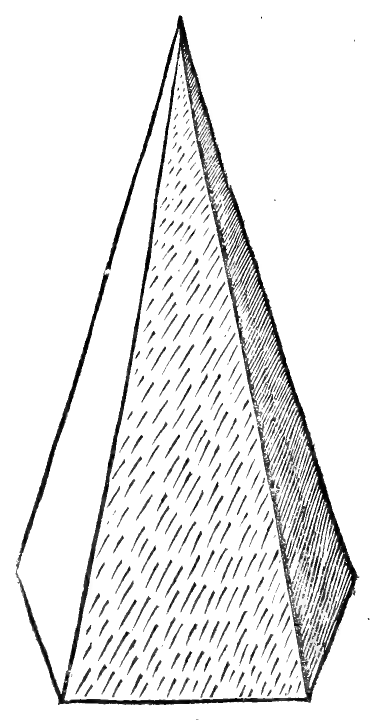

:layout: book
:canonical_id: Plate LI
:folio: 0293

.. _plates-polyhedra-plate_52:
.. _plates-polyhedra-plate_52-en:

Plate LI (Folio 0293) — Solid Pentagonal Pyramid
================================================

.. rubric:: Perspective Woodcut by Leonardo da Vinci (1509)

.. folio:: 0293

   **Solid Pentagonal Pyramid** — *Pyramis Laterata Penthagona Solida* (:term:`Πυραμὶς πλευρώδης πεντάγωνος <pyramide-pentagona>` στερεά)
