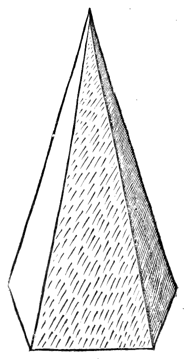

:layout: book
:canonical_id: Tabula LI
:folio: 0293

.. _plates-polyhedra-plate_52-la:

Tabula LI (Folio 0293) — Pyramis Laterata Penthagona Solida
===========================================================

.. rubric:: Figura Geometrica per Manum Leonardi Vincii (1509)

.. folio:: 0293

   *Pyramis Laterata Penthagona Solida* (:term:`Πυραμὶς πλευρώδης πεντάγωνος <pyramide-pentagona>` στερεά)
