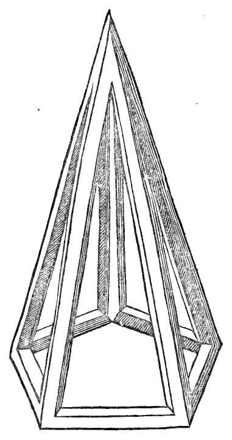

:layout: book
:canonical_id: Plate LII
:folio: 0295

.. _plates-polyhedra-plate_53:
.. _plates-polyhedra-plate_53-en:

Plate LII (Folio 0295) — Hollow Pentagonal Pyramid
==================================================

.. rubric:: Perspective Woodcut by Leonardo da Vinci (1509)

.. folio:: 0295

   **Hollow Pentagonal Pyramid** — *Pyramis Laterata Penthagona Vacua* (:term:`Πυραμὶς πλευρώδης πεντάγωνος <pyramide-pentagona>` κενή)
