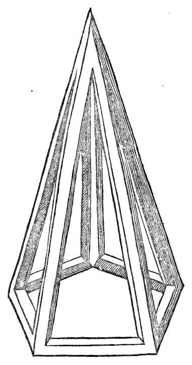

:layout: book
:canonical_id: Tabula LII
:folio: 0295

.. _plates-polyhedra-plate_53-la:

Tabula LII (Folio 0295) — Pyramis Laterata Penthagona Vacua
===========================================================

.. rubric:: Figura Geometrica per Manum Leonardi Vincii (1509)

.. folio:: 0295

   *Pyramis Laterata Penthagona Vacua* (:term:`Πυραμὶς πλευρώδης πεντάγωνος <pyramide-pentagona>` κενή)
