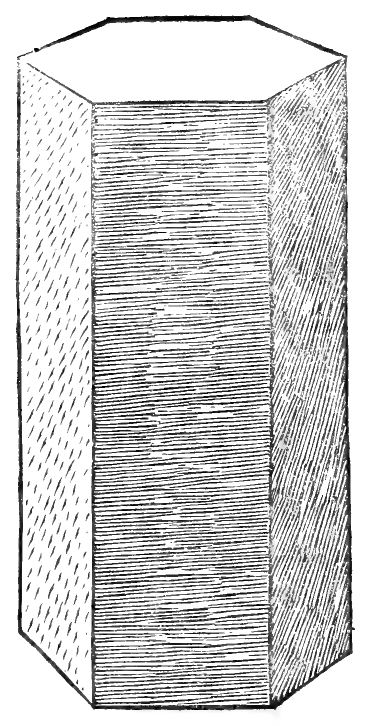

:layout: book
:canonical_id: Plate LIII
:folio: 0297

.. _plates-polyhedra-plate_54:
.. _plates-polyhedra-plate_54-en:

Plate LIII (Folio 0297) — Solid Hexagonal Prism
===============================================

.. rubric:: Perspective Woodcut by Leonardo da Vinci (1509)

.. folio:: 0297

   **Solid Hexagonal Prism** — :term:`*Columna Laterata Exagona Solida* <colonna-exagona>` (:term:`Κίων πλευρώδης ἑξάγωνος <colonna-exagona>` στερεός)
