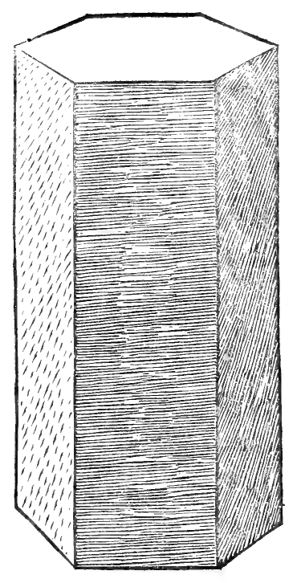

:layout: book
:canonical_id: Tabula LIII
:folio: 0297

.. _plates-polyhedra-plate_54-la:

Tabula LIII (Folio 0297) — Columna Laterata Exagona Solida
==========================================================

.. rubric:: Figura Geometrica per Manum Leonardi Vincii (1509)

.. folio:: 0297

   :term:`*Columna Laterata Exagona Solida* <colonna-exagona>` (:term:`Κίων πλευρώδης ἑξάγωνος <colonna-exagona>` στερεός)
