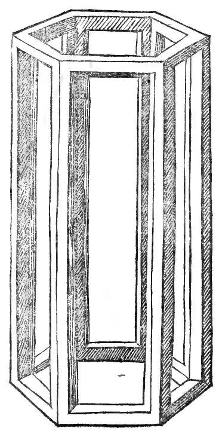

:layout: book
:canonical_id: Plate LIIII
:folio: 0299

.. _plates-polyhedra-plate_55:
.. _plates-polyhedra-plate_55-en:

Plate LIIII (Folio 0299) — Hollow Hexagonal Prism
=================================================

.. rubric:: Perspective Woodcut by Leonardo da Vinci (1509)

.. folio:: 0299

   **Hollow Hexagonal Prism** — :term:`*Columna Laterata Exagona Vacua* <colonna-exagona>` (:term:`Κίων πλευρώδης ἑξάγωνος <colonna-exagona>` κενός)
