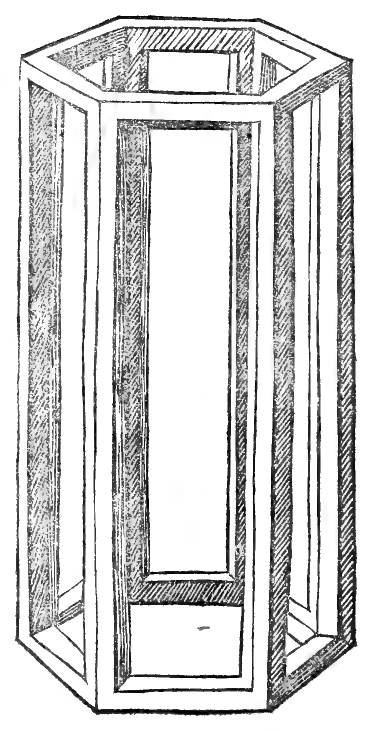

:layout: book
:canonical_id: Tabula LIIII
:folio: 0299

.. _plates-polyhedra-plate_55-la:

Tabula LIIII (Folio 0299) — Columna Laterata Exagona Vacua
==========================================================

.. rubric:: Figura Geometrica per Manum Leonardi Vincii (1509)

.. folio:: 0299

   :term:`*Columna Laterata Exagona Vacua* <colonna-exagona>` (:term:`Κίων πλευρώδης ἑξάγωνος <colonna-exagona>` κενός)
