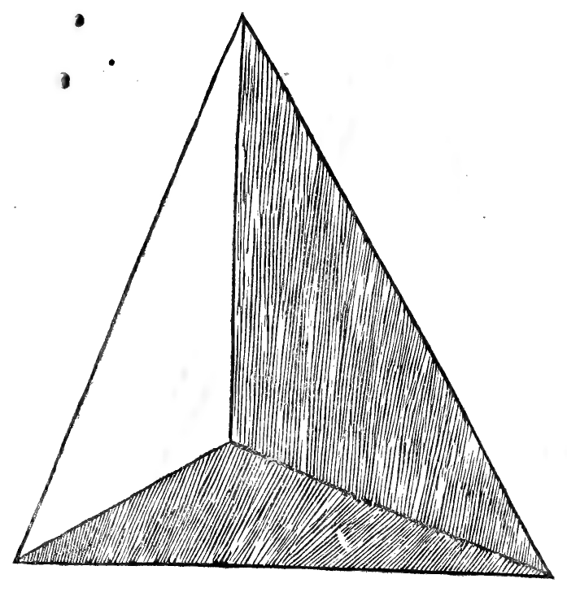

:layout: book
:canonical_id: Plate LV
:folio: 0301

.. _plates-polyhedra-plate_56:
.. _plates-polyhedra-plate_56-en:

Plate LV (Folio 0301) — Solid Scalene Triangular Pyramid
========================================================

.. rubric:: Perspective Woodcut by Leonardo da Vinci (1509)

.. folio:: 0301

   **Solid Scalene Triangular Pyramid** — :term:`*Pyramis Laterata Triangula Inaequilatera Solida* <pyramide-triangula>` (:term:`Πυραμὶς πλευρώδης τρίγωνος <pyramide-triangula>` ἀνισόπλευρος στερεά)
