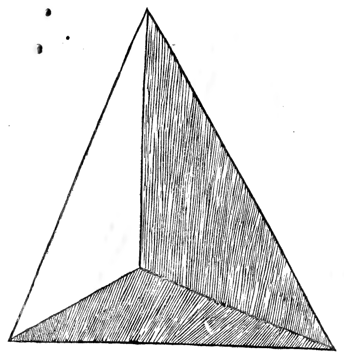

:layout: book
:canonical_id: Tabula LV
:folio: 0301

.. _plates-polyhedra-plate_56-la:

Tabula LV (Folio 0301) — Pyramis Laterata Triangula Inaequilatera Solida
========================================================================

.. rubric:: Figura Geometrica per Manum Leonardi Vincii (1509)

.. folio:: 0301

   :term:`*Pyramis Laterata Triangula Inaequilatera Solida* <pyramide-triangula>` (:term:`Πυραμὶς πλευρώδης τρίγωνος <pyramide-triangula>` ἀνισόπλευρος στερεά)
