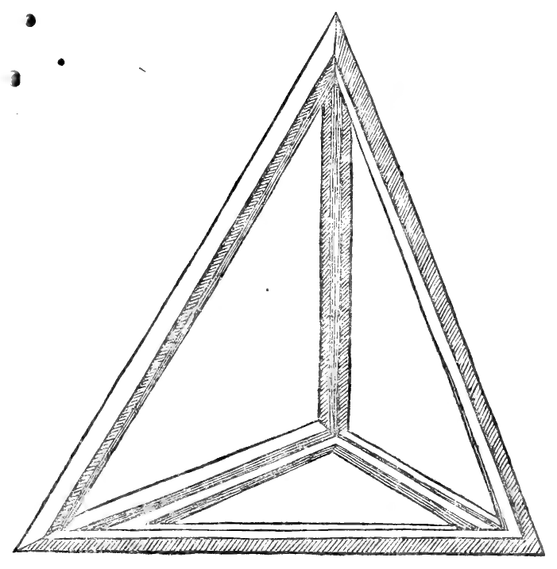

:layout: book
:canonical_id: Plate LVI
:folio: 0303

.. _plates-polyhedra-plate_57:
.. _plates-polyhedra-plate_57-en:

Plate LVI (Folio 0303) — Hollow Scalene Triangular Pyramid
==========================================================

.. rubric:: Perspective Woodcut by Leonardo da Vinci (1509)

.. folio:: 0303

   **Hollow Scalene Triangular Pyramid** — :term:`*Pyramis Laterata Triangula Inaequilatera Vacua* <pyramide-triangula>` (:term:`Πυραμὶς πλευρώδης τρίγωνος <pyramide-triangula>` ἀνισόπλευρος κενή)
