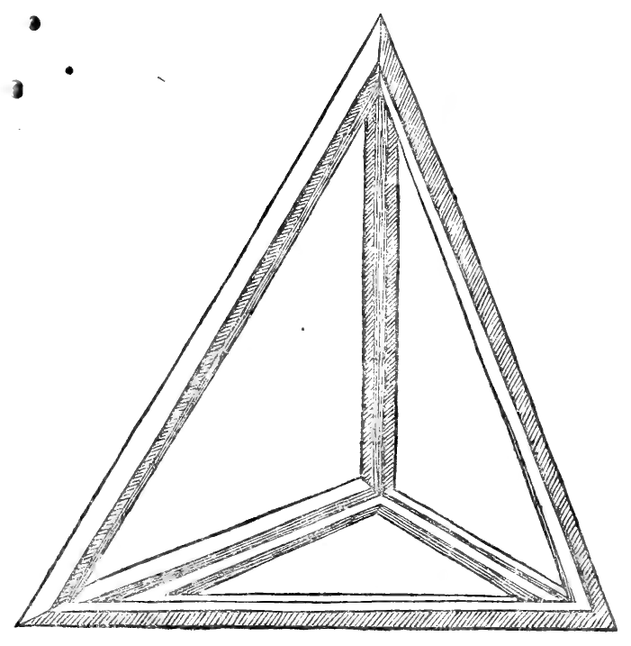

:layout: book
:canonical_id: Tabula LVI
:folio: 0303

.. _plates-polyhedra-plate_57-la:

Tabula LVI (Folio 0303) — Pyramis Laterata Triangula Inaequilatera Vacua
========================================================================

.. rubric:: Figura Geometrica per Manum Leonardi Vincii (1509)

.. folio:: 0303

   :term:`*Pyramis Laterata Triangula Inaequilatera Vacua* <pyramide-triangula>` (:term:`Πυραμὶς πλευρώδης τρίγωνος <pyramide-triangula>` ἀνισόπλευρος κενή)
