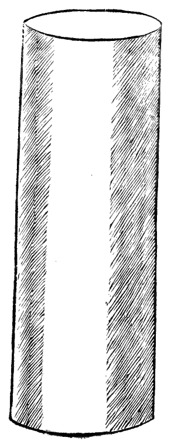

:layout: book
:canonical_id: Plate LVII
:folio: 0305

.. _plates-polyhedra-plate_58:
.. _plates-polyhedra-plate_58-en:

Plate LVII (Folio 0305) — Solid Round Column (Cylinder)
=======================================================

.. rubric:: Perspective Woodcut by Leonardo da Vinci (1509)

.. folio:: 0305

   **Solid Round Column (Cylinder)** — :term:`*Columna Rotunda Solida* <colonna-rotonda>` (:term:`Κίων στρογγύλος <colonna-rotonda>` στερεός)
