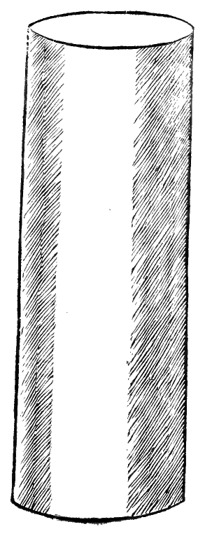

:layout: book
:canonical_id: Tabula LVII
:folio: 0305

.. _plates-polyhedra-plate_58-la:

Tabula LVII (Folio 0305) — Columna Rotunda Solida
=================================================

.. rubric:: Figura Geometrica per Manum Leonardi Vincii (1509)

.. folio:: 0305

   :term:`*Columna Rotunda Solida* <colonna-rotonda>` (:term:`Κίων στρογγύλος <colonna-rotonda>` στερεός)
