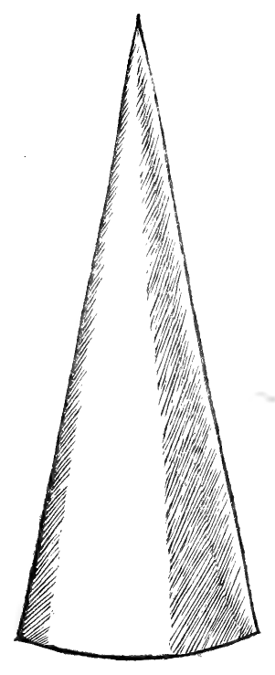

:layout: book
:canonical_id: Plate LVIII
:folio: 0307

.. _plates-polyhedra-plate_59:
.. _plates-polyhedra-plate_59-en:

Plate LVIII (Folio 0307) — Solid Round Pyramid (Cone)
=====================================================

.. rubric:: Perspective Woodcut by Leonardo da Vinci (1509)

.. folio:: 0307

   **Solid Round Pyramid (Cone)** — :term:`*Pyramis Rotunda Solida* <pyramide-rotonda>` (:term:`Πυραμὶς στρογγύλη <pyramide-rotonda>` στερεά)
