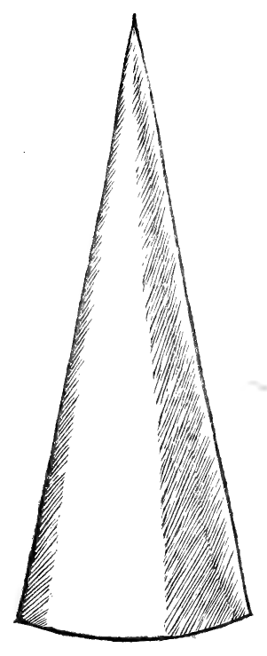

:layout: book
:canonical_id: Tabula LVIII
:folio: 0307

.. _plates-polyhedra-plate_59-la:

Tabula LVIII (Folio 0307) — Pyramis Rotunda Solida
==================================================

.. rubric:: Figura Geometrica per Manum Leonardi Vincii (1509)

.. folio:: 0307

   :term:`*Pyramis Rotunda Solida* <pyramide-rotonda>` (:term:`Πυραμὶς στρογγύλη <pyramide-rotonda>` στερεά)
