:layout: book
:canonical_id: Appendix III
:folio: 0187–0309

.. _plates-polyhedra-la:

Appendix III: Tabulae Corporum Regularium et Dependentium
=========================================================

.. rubric:: Sexaginta Tabulae Corporum Geometricorum per Manum Leonardi Vincii Florentini (1509)

Full-page woodcut plates designed by :person:`**Leonardo da Vinci** <leonardo>` (*per mano del nostro Lionardo da Vinci Fiorentino*), carrying their original 1509 Latin and Greek cartouches.

Tabula I (Folio 0187) — Tetrahedron Planum Solidum
--------------------------------------------------

.. folio:: 0187

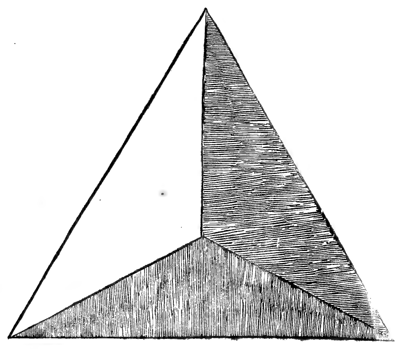

   :term:`*Tetrahedron Planum Solidum* <tetrahedron>` (:term:`Τετράεδρον <tetrahedron>` :term:`ἐπίπεδον <planum>` :term:`στερεόν <solidum>`)

Tabula II (Folio 0189) — Tetrahedron Planum Vacuum
--------------------------------------------------

.. folio:: 0189

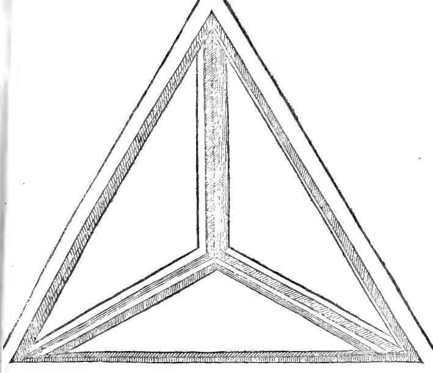

   :term:`*Tetrahedron Planum Vacuum* <tetrahedron>` (:term:`Τετράεδρον <tetrahedron>` :term:`ἐπίπεδον <planum>` :term:`κενόν <vacuum>`)

Tabula III (Folio 0191) — Tetrahedron Abscisum Solidum
------------------------------------------------------

.. folio:: 0191

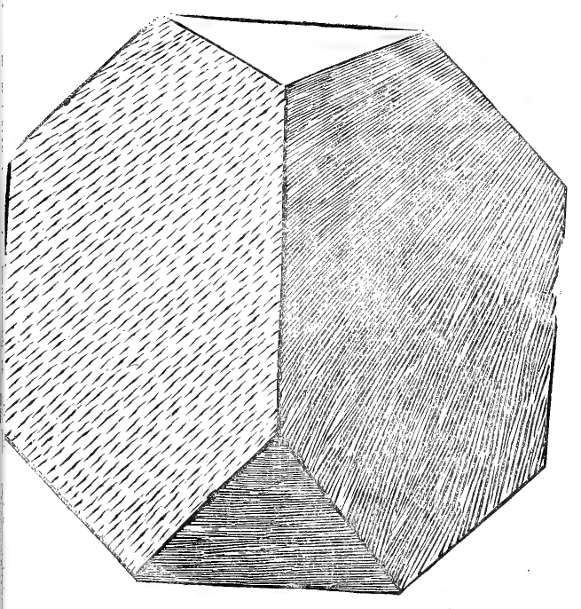

   :term:`*Tetrahedron Abscisum Solidum* <tetrahedron-abscisum>` (:term:`Τετράεδρον ἀποτετμημένον <tetrahedron-abscisum>` :term:`στερεόν <solidum>`)

Tabula IIII (Folio 0193) — Tetrahedron Abscisum Vacuum
------------------------------------------------------

.. folio:: 0193

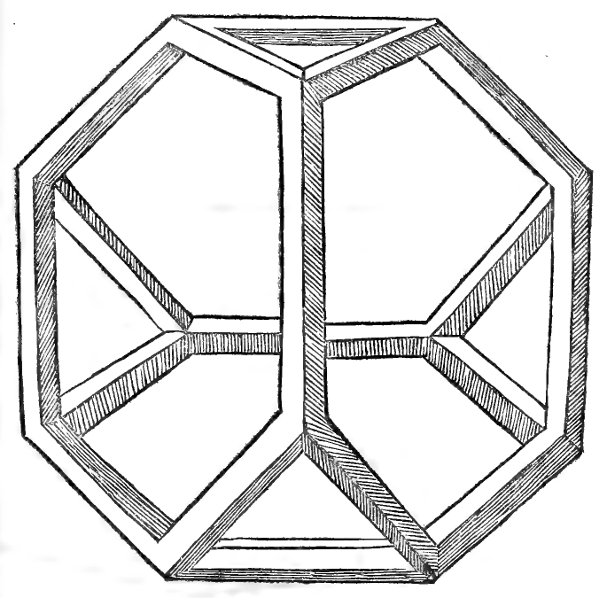

   :term:`*Tetrahedron Abscisum Vacuum* <tetrahedron-abscisum>` (:term:`Τετράεδρον ἀποτετμημένον <tetrahedron-abscisum>` :term:`κενόν <vacuum>`)

Tabula V (Folio 0195) — Tetrahedron Elevatum Solidum
----------------------------------------------------

.. folio:: 0195

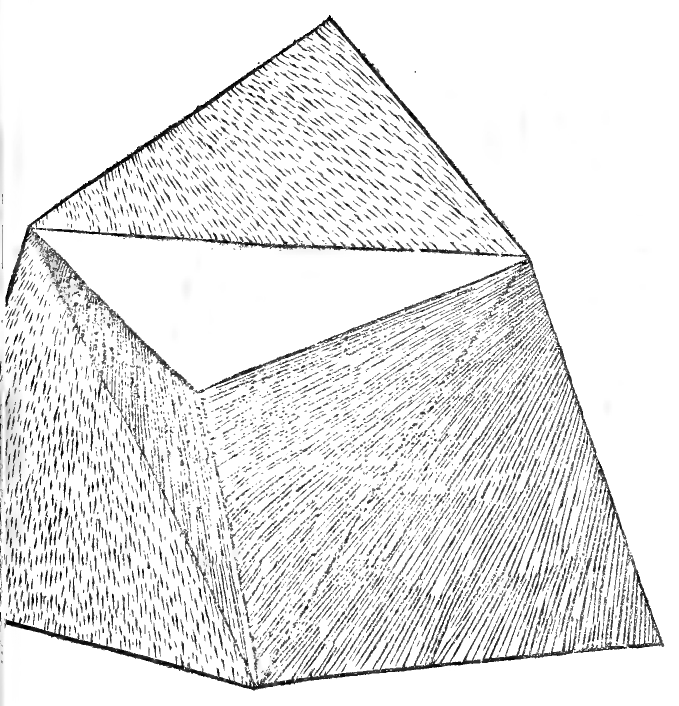

   :term:`*Tetrahedron Elevatum Solidum* <tetrahedron-elevatum>` (:term:`Τετράεδρον ἐπηρμένον <tetrahedron-elevatum>` :term:`στερεόν <solidum>`)

Tabula VI (Folio 0197) — Tetrahedron Elevatum Vacuum
----------------------------------------------------

.. folio:: 0197

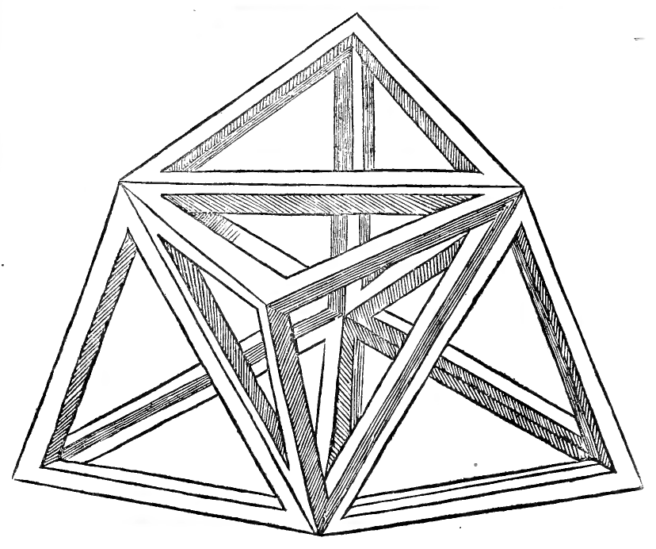

   :term:`*Tetrahedron Elevatum Vacuum* <tetrahedron-elevatum>` (:term:`Τετράεδρον ἐπηρμένον <tetrahedron-elevatum>` :term:`κενόν <vacuum>`)

Tabula VII (Folio 0199) — Exahedron sive Cubus Planum Solidum
-------------------------------------------------------------

.. folio:: 0199

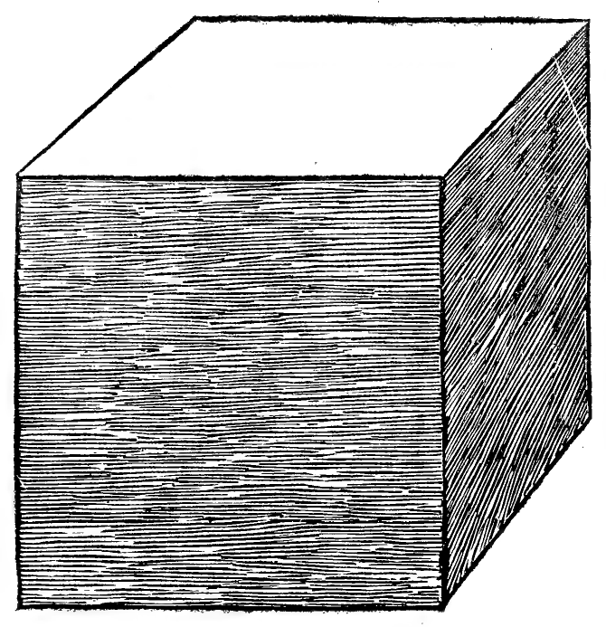

   :term:`*Exahedron sive Cubus Planum Solidum* <exahedron>` (:term:`Ἑξάεδρον <exahedron>` ἢ κύβος :term:`ἐπίπεδον <planum>` :term:`στερεόν <solidum>`)

Tabula VIII (Folio 0201) — Exahedron Planum Vacuum
--------------------------------------------------

.. folio:: 0201

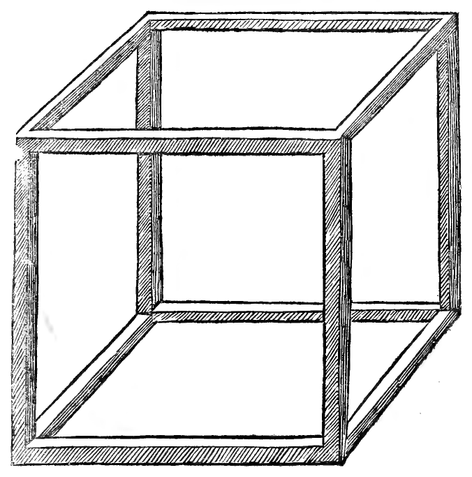

   :term:`*Exahedron Planum Vacuum* <exahedron>` (:term:`Ἑξάεδρον <exahedron>` :term:`ἐπίπεδον <planum>` :term:`κενόν <vacuum>`)

Tabula VIIII (Folio 0203) — Exahedron Abscisum Solidum
------------------------------------------------------

.. folio:: 0203

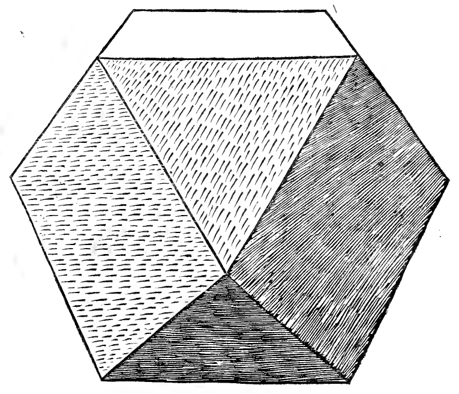

   :term:`*Exahedron Abscisum Solidum* <exahedron-abscisum>` (:term:`Ἑξάεδρον ἀποτετμημένον <exahedron-abscisum>` :term:`στερεόν <solidum>`)

Tabula X (Folio 0205) — Exahedron Abscisum Vacuum
-------------------------------------------------

.. folio:: 0205

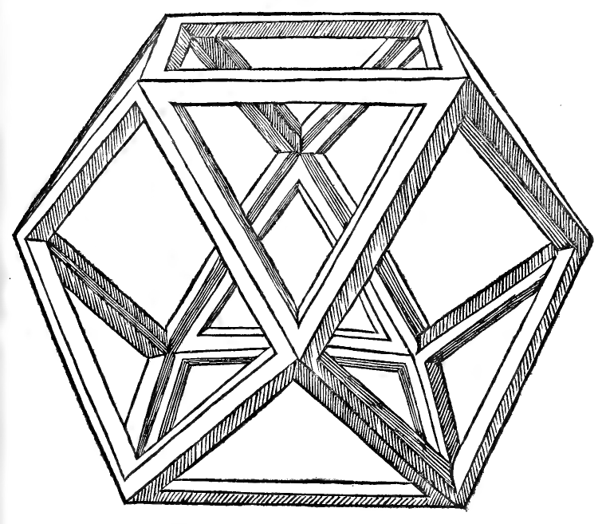

   :term:`*Exahedron Abscisum Vacuum* <exahedron-abscisum>` (:term:`Ἑξάεδρον ἀποτετμημένον <exahedron-abscisum>` :term:`κενόν <vacuum>`)

Tabula XI (Folio 0207) — Exahedron Elevatum Solidum
---------------------------------------------------

.. folio:: 0207

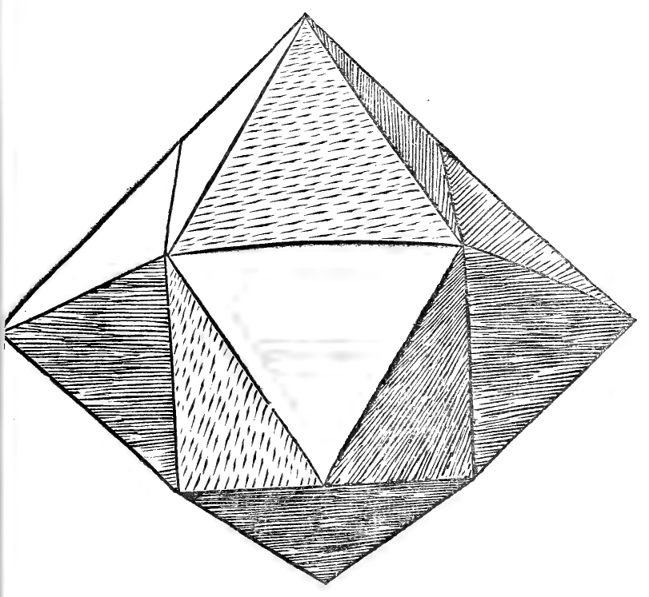

   :term:`*Exahedron Elevatum Solidum* <exahedron-elevatum>` (:term:`Ἑξάεδρον ἐπηρμένον <exahedron-elevatum>` :term:`στερεόν <solidum>`)

Tabula XII (Folio 0209) — Exahedron Elevatum Vacuum
---------------------------------------------------

.. folio:: 0209

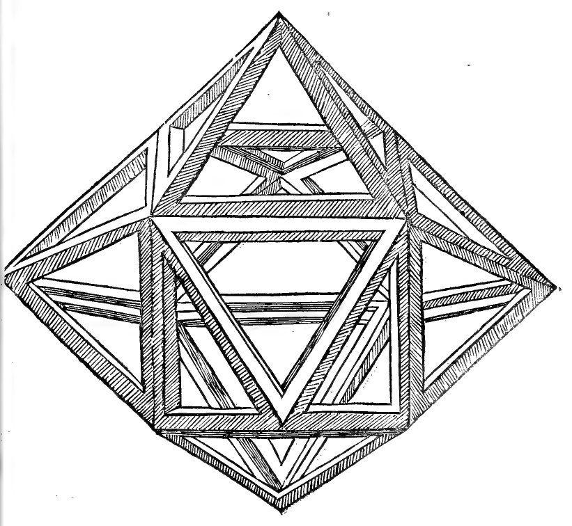

   :term:`*Exahedron Elevatum Vacuum* <exahedron-elevatum>` (:term:`Ἑξάεδρον ἐπηρμένον <exahedron-elevatum>` :term:`κενόν <vacuum>`)

Tabula XIII (Folio 0211) — Exahedron Abscisum Elevatum Solidum
--------------------------------------------------------------

.. folio:: 0211

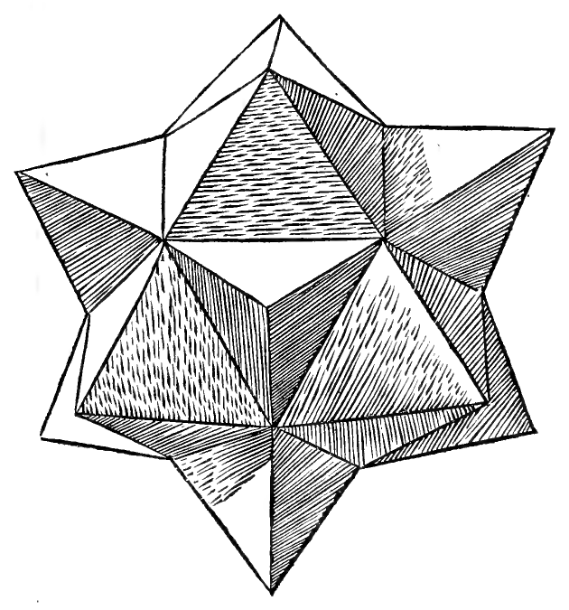

   :term:`*Exahedron Abscisum Elevatum Solidum* <exahedron-abscisum-elevatum>` (:term:`Ἑξάεδρον ἀποτετμημένον ἐπηρμένον <exahedron-abscisum-elevatum>` :term:`στερεόν <solidum>`)

Tabula XIIII (Folio 0217) — Exahedron Abscisum Elevatum Vacuum
--------------------------------------------------------------

.. folio:: 0217

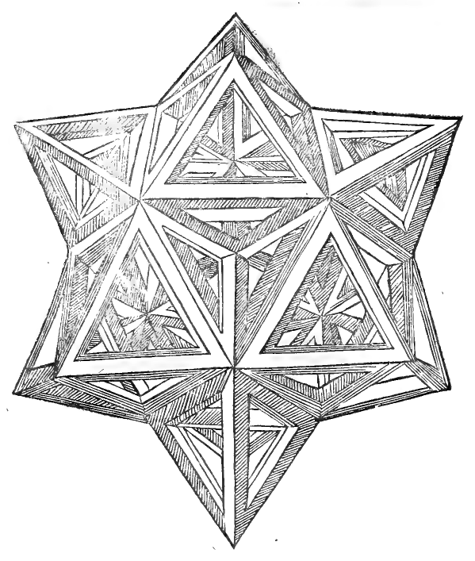

   :term:`*Exahedron Abscisum Elevatum Vacuum* <exahedron-abscisum-elevatum>` (:term:`Ἑξάεδρον ἀποτετμημένον ἐπηρμένον <exahedron-abscisum-elevatum>` :term:`κενόν <vacuum>`)

Tabula XV (Folio 0219) — Octahedron Planum Solidum
--------------------------------------------------

.. folio:: 0219

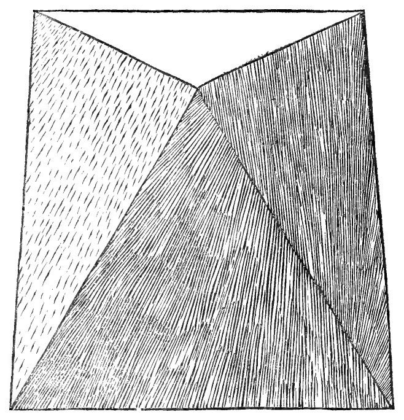

   :term:`*Octahedron Planum Solidum* <octahedron>` (:term:`Ὀκτάεδρον <octahedron>` :term:`ἐπίπεδον <planum>` :term:`στερεόν <solidum>`)

Tabula XVI (Folio 0221) — Octahedron Planum Vacuum
--------------------------------------------------

.. folio:: 0221

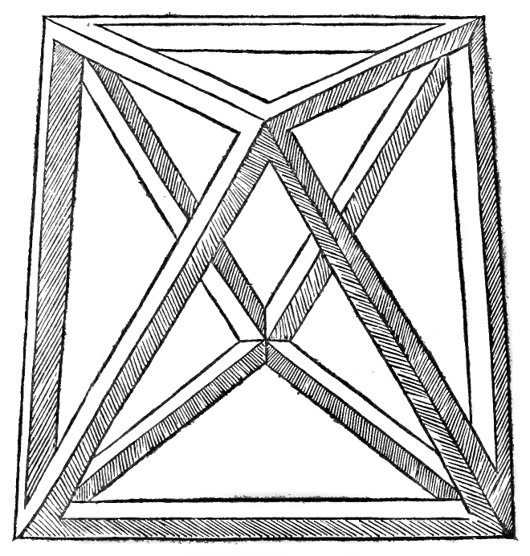

   :term:`*Octahedron Planum Vacuum* <octahedron>` (:term:`Ὀκτάεδρον <octahedron>` :term:`ἐπίπεδον <planum>` :term:`κενόν <vacuum>`)

Tabula XVII (Folio 0223) — Octahedron Abscisum Solidum
------------------------------------------------------

.. folio:: 0223

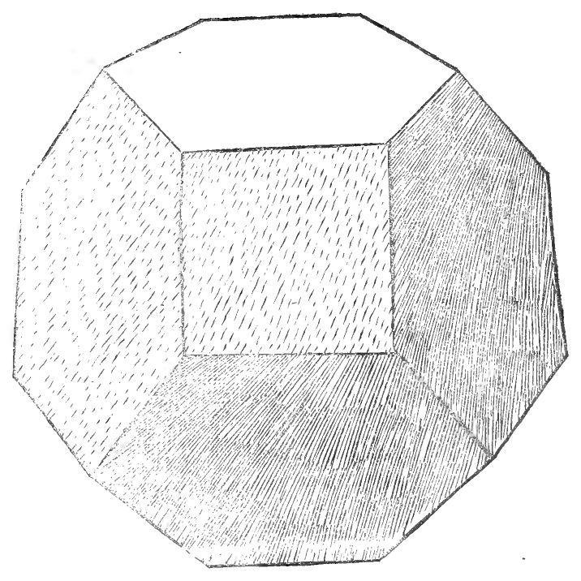

   :term:`*Octahedron Abscisum Solidum* <octahedron-abscisum>` (:term:`Ὀκτάεδρον ἀποτετμημένον <octahedron-abscisum>` :term:`στερεόν <solidum>`)

Tabula XVIII (Folio 0225) — Octahedron Abscisum Vacuum
------------------------------------------------------

.. folio:: 0225

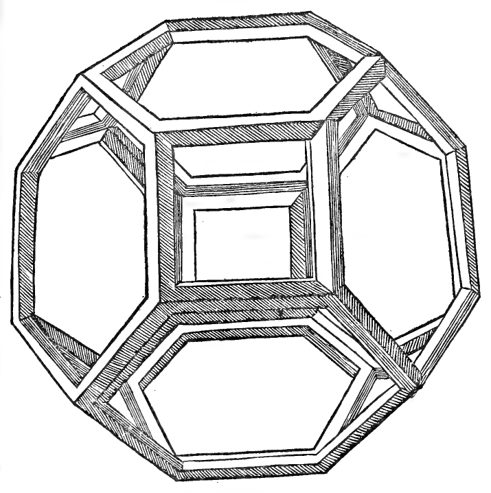

   :term:`*Octahedron Abscisum Vacuum* <octahedron-abscisum>` (:term:`Ὀκτάεδρον ἀποτετμημένον <octahedron-abscisum>` :term:`κενόν <vacuum>`)

Tabula XIX (Folio 0227) — Octahedron Elevatum Solidum
-----------------------------------------------------

.. folio:: 0227

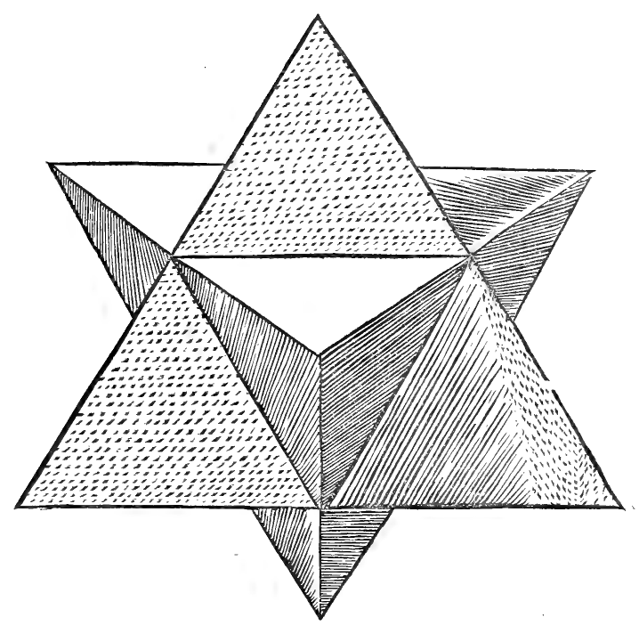

   :term:`*Octahedron Elevatum Solidum* <octahedron-elevatum>` (:term:`Ὀκτάεδρον ἐπηρμένον <octahedron-elevatum>` :term:`στερεόν <solidum>`)

Tabula XX (Folio 0229) — Octahedron Elevatum Vacuum
---------------------------------------------------

.. folio:: 0229

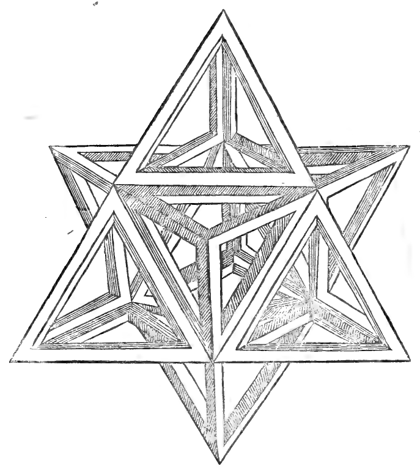

   :term:`*Octahedron Elevatum Vacuum* <octahedron-elevatum>` (:term:`Ὀκτάεδρον ἐπηρμένον <octahedron-elevatum>` :term:`κενόν <vacuum>`)

Tabula XXI (Folio 0231) — Icosahedron Planum Solidum
----------------------------------------------------

.. folio:: 0231

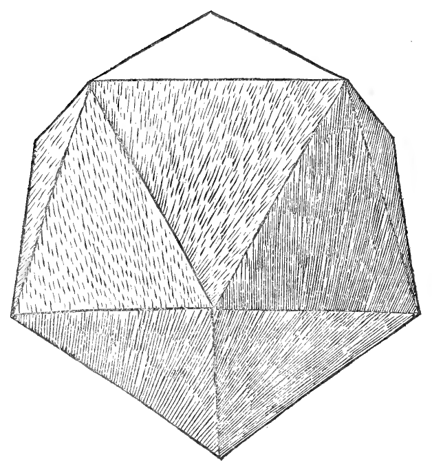

   :term:`*Icosahedron Planum Solidum* <icosahedron>` (:term:`Εἰκοσάεδρον <icosahedron>` :term:`ἐπίπεδον <planum>` :term:`στερεόν <solidum>`)

Tabula XXII (Folio 0233) — Icosahedron Planum Vacuum
----------------------------------------------------

.. folio:: 0233

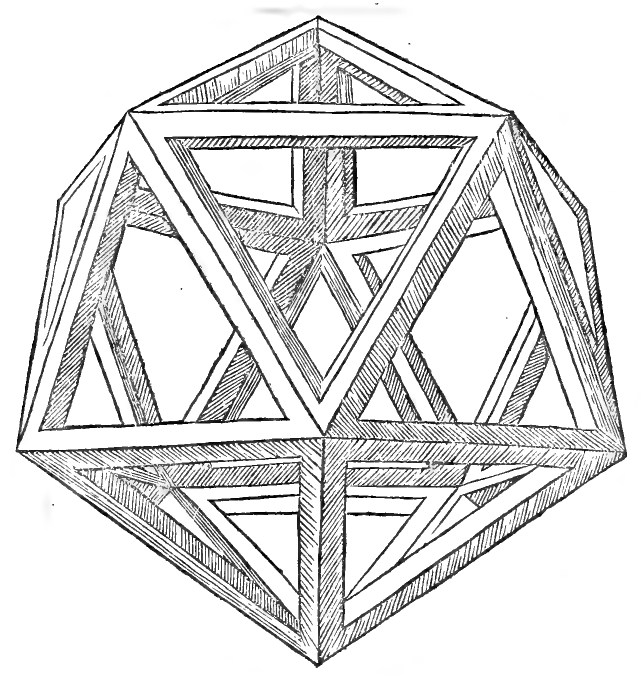

   :term:`*Icosahedron Planum Vacuum* <icosahedron>` (:term:`Εἰκοσάεδρον <icosahedron>` :term:`ἐπίπεδον <planum>` :term:`κενόν <vacuum>`)

Tabula XXIII (Folio 0235) — Icosahedron Abscisum Solidum
--------------------------------------------------------

.. folio:: 0235

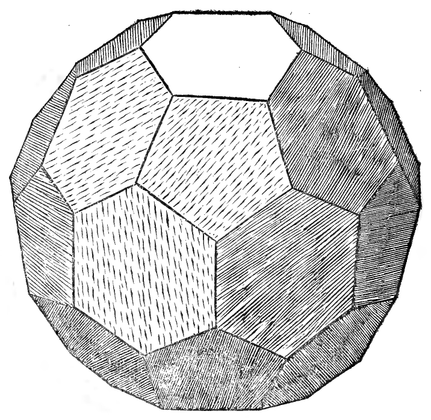

   :term:`*Icosahedron Abscisum Solidum* <icosahedron-abscisum>` (:term:`Εἰκοσάεδρον ἀποτετμημένον <icosahedron-abscisum>` :term:`στερεόν <solidum>`)

Tabula XXIIII (Folio 0237) — Icosahedron Abscisum Vacuum
--------------------------------------------------------

.. folio:: 0237

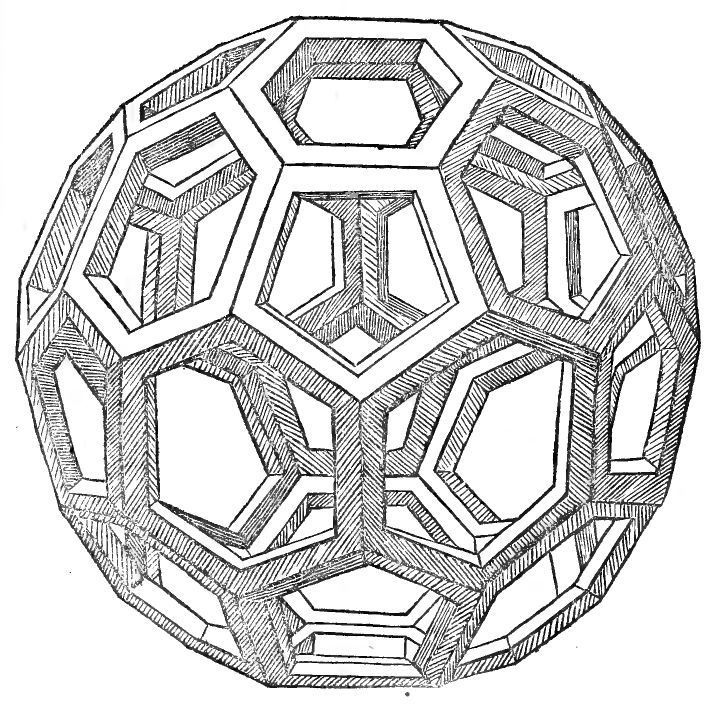

   :term:`*Icosahedron Abscisum Vacuum* <icosahedron-abscisum>` (:term:`Εἰκοσάεδρον ἀποτετμημένον <icosahedron-abscisum>` :term:`κενόν <vacuum>`)

Tabula XXV (Folio 0239) — Icosahedron Elevatum Solidum
------------------------------------------------------

.. folio:: 0239

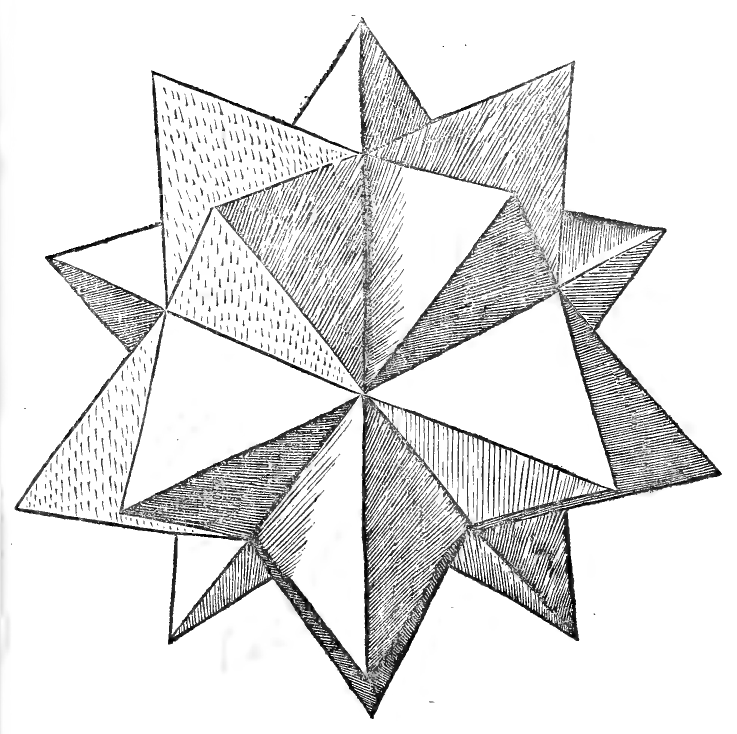

   :term:`*Icosahedron Elevatum Solidum* <icosahedron-elevatum>` (:term:`Εἰκοσάεδρον ἐπηρμένον <icosahedron-elevatum>` :term:`στερεόν <solidum>`)

Tabula XXVI (Folio 0241) — Icosahedron Elevatum Vacuum
------------------------------------------------------

.. folio:: 0241

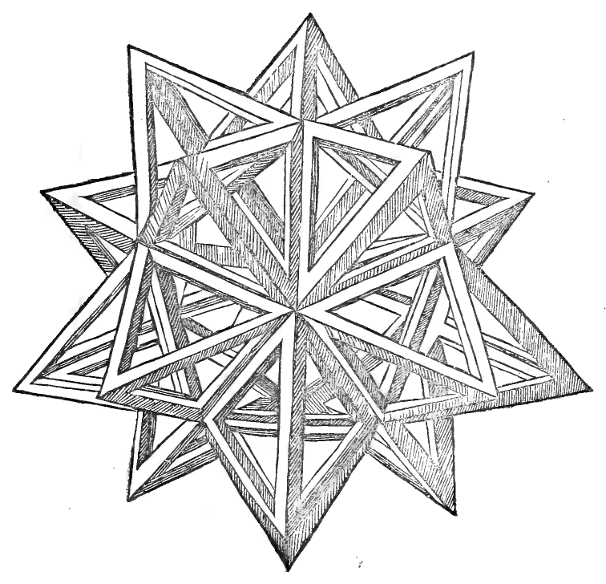

   :term:`*Icosahedron Elevatum Vacuum* <icosahedron-elevatum>` (:term:`Εἰκοσάεδρον ἐπηρμένον <icosahedron-elevatum>` :term:`κενόν <vacuum>`)

Tabula XXVII (Folio 0243) — Dodecahedron Planum Solidum
-------------------------------------------------------

.. folio:: 0243

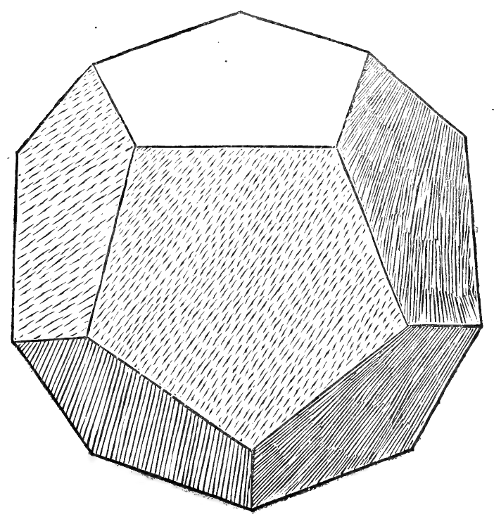

   :term:`*Dodecahedron Planum Solidum* <dodecahedron>` (:term:`Δωδεκάεδρον <dodecahedron>` :term:`ἐπίπεδον <planum>` :term:`στερεόν <solidum>`)

Tabula XXVIII (Folio 0245) — Dodecahedron Planum Vacuum
-------------------------------------------------------

.. folio:: 0245

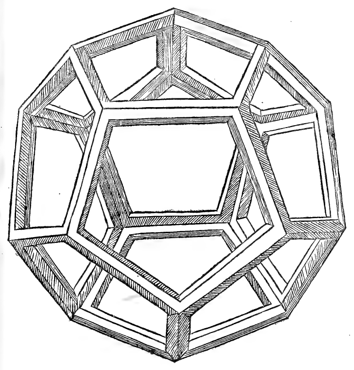

   :term:`*Dodecahedron Planum Vacuum* <dodecahedron>` (:term:`Δωδεκάεδρον <dodecahedron>` :term:`ἐπίπεδον <planum>` :term:`κενόν <vacuum>`)

Tabula XXIX (Folio 0247) — Dodecahedron Abscisum Solidum
--------------------------------------------------------

.. folio:: 0247

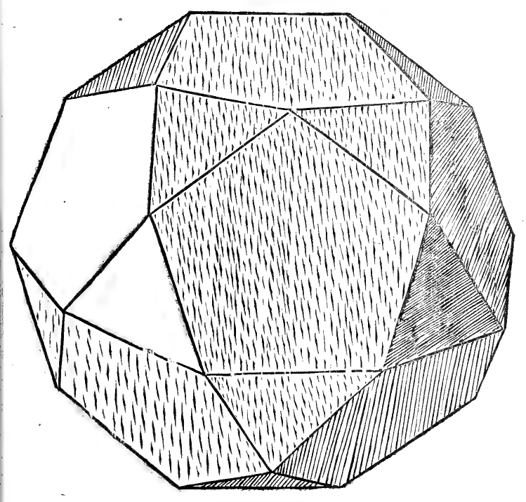

   :term:`*Dodecahedron Abscisum Solidum* <dodecahedron-abscisum>` (:term:`Δωδεκάεδρον ἀποτετμημένον <dodecahedron-abscisum>` :term:`στερεόν <solidum>`)

Tabula XXX (Folio 0249) — Dodecahedron Abscisum Vacuum
------------------------------------------------------

.. folio:: 0249

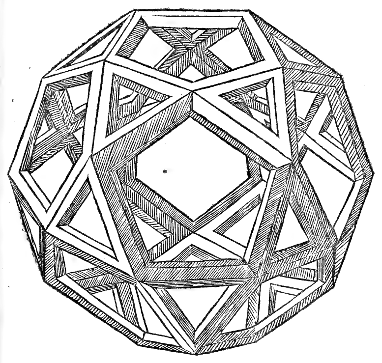

   :term:`*Dodecahedron Abscisum Vacuum* <dodecahedron-abscisum>` (:term:`Δωδεκάεδρον ἀποτετμημένον <dodecahedron-abscisum>` :term:`κενόν <vacuum>`)

Tabula XXXI (Folio 0251) — Dodecahedron Elevatum Solidum
--------------------------------------------------------

.. folio:: 0251

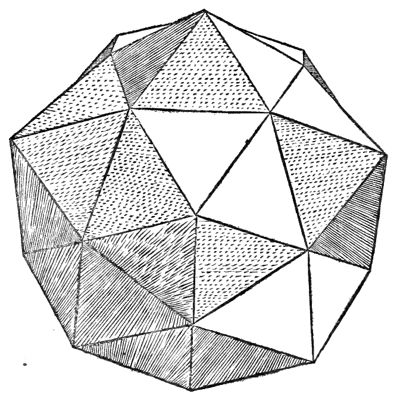

   :term:`*Dodecahedron Elevatum Solidum* <dodecahedron-elevatum>` (:term:`Δωδεκάεδρον ἐπηρμένον <dodecahedron-elevatum>` :term:`στερεόν <solidum>`)

Tabula XXXII (Folio 0253) — Dodecahedron Elevatum Vacuum
--------------------------------------------------------

.. folio:: 0253

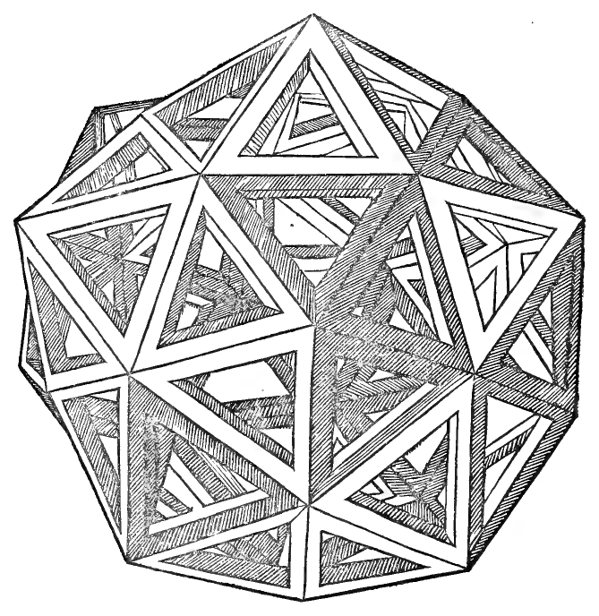

   :term:`*Dodecahedron Elevatum Vacuum* <dodecahedron-elevatum>` (:term:`Δωδεκάεδρον ἐπηρμένον <dodecahedron-elevatum>` :term:`κενόν <vacuum>`)

Tabula XXXIII (Folio 0255) — Dodecahedron Abscisum Elevatum Solidum
-------------------------------------------------------------------

.. folio:: 0255

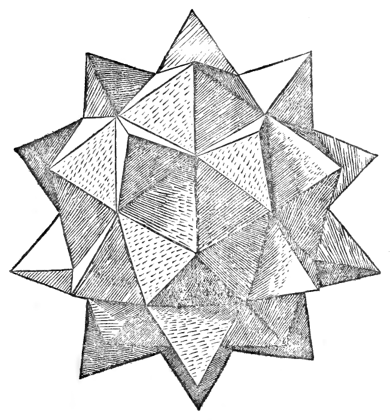

   :term:`*Dodecahedron Abscisum Elevatum Solidum* <dodecahedron-abscisum-elevatum>` (:term:`Δωδεκάεδρον ἀποτετμημένον ἐπηρμένον <dodecahedron-abscisum-elevatum>` :term:`στερεόν <solidum>`)

Tabula XXXIIII (Folio 0257) — Dodecahedron Abscisum Elevatum Vacuum
-------------------------------------------------------------------

.. folio:: 0257

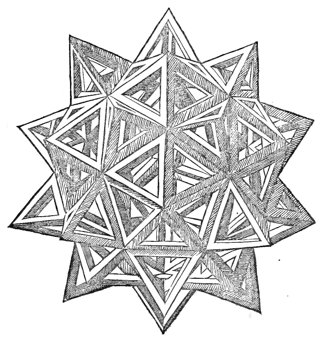

   :term:`*Dodecahedron Abscisum Elevatum Vacuum* <dodecahedron-abscisum-elevatum>` (:term:`Δωδεκάεδρον ἀποτετμημένον ἐπηρμένον <dodecahedron-abscisum-elevatum>` :term:`κενόν <vacuum>`)

Tabula XXXV (Folio 0259) — Vigintisex Basium Planum Solidum
-----------------------------------------------------------

.. folio:: 0259

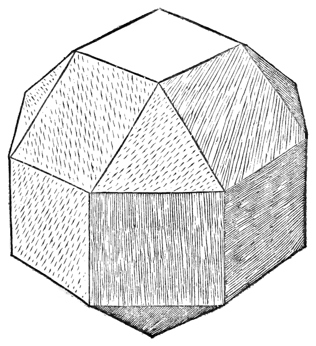

   :term:`*Vigintisex Basium Planum Solidum* <vigintisex-basium>` (:term:`Εἰκοσιεξάεδρον <vigintisex-basium>` :term:`ἐπίπεδον <planum>` :term:`στερεόν <solidum>`)

Tabula XXXVI (Folio 0261) — Vigintisex Basium Planum Vacuum
-----------------------------------------------------------

.. folio:: 0261

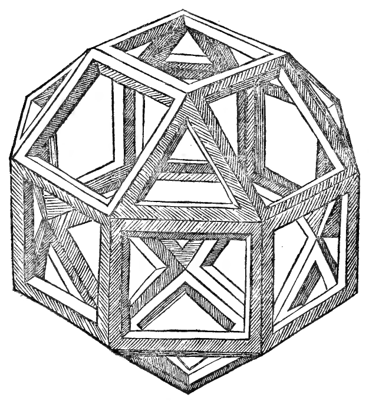

   :term:`*Vigintisex Basium Planum Vacuum* <vigintisex-basium>` (:term:`Εἰκοσιεξάεδρον <vigintisex-basium>` :term:`ἐπίπεδον <planum>` :term:`κενόν <vacuum>`)

Tabula XXXVII (Folio 0263) — Vigintisex Basium Abscisum Elevatum Solidum
------------------------------------------------------------------------

.. folio:: 0263

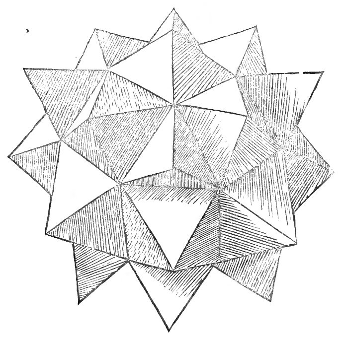

   :term:`*Vigintisex Basium Abscisum Elevatum Solidum* <vigintisex-basium>` (:term:`Εἰκοσιεξάεδρον <vigintisex-basium>` :term:`ἀποτετμημένον <abscisum>` :term:`ἐπηρμένον <elevatum>` :term:`στερεόν <solidum>`)

Tabula XXXVIII (Folio 0265) — Vigintisex Basium Abscisum Elevatum Vacuum
------------------------------------------------------------------------

.. folio:: 0265

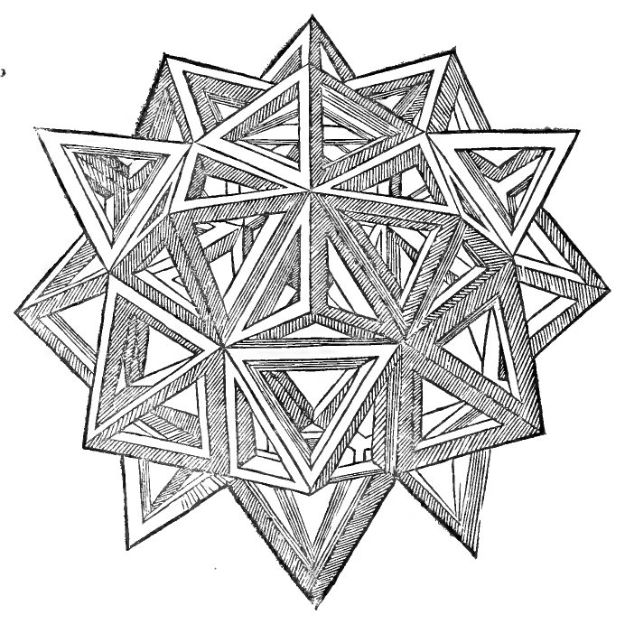

   :term:`*Vigintisex Basium Abscisum Elevatum Vacuum* <vigintisex-basium>` (:term:`Εἰκοσιεξάεδρον <vigintisex-basium>` :term:`ἀποτετμημένον <abscisum>` :term:`ἐπηρμένον <elevatum>` :term:`κενόν <vacuum>`)

Tabula XXXIX (Folio 0267) — Septuaginta Duarum Basium Solidum
-------------------------------------------------------------

.. folio:: 0267

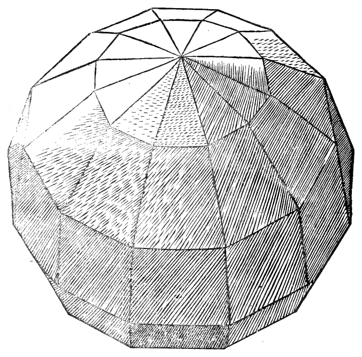

   :term:`*Septuaginta Duarum Basium Solidum* <septuaginta-duarum-basium>` (:term:`Ἑβδομηκονταδισσάεδρον <septuaginta-duarum-basium>` :term:`στερεόν <solidum>`)

Tabula XL (Folio 0269) — Septuaginta Duarum Basium Vacuum
---------------------------------------------------------

.. folio:: 0269

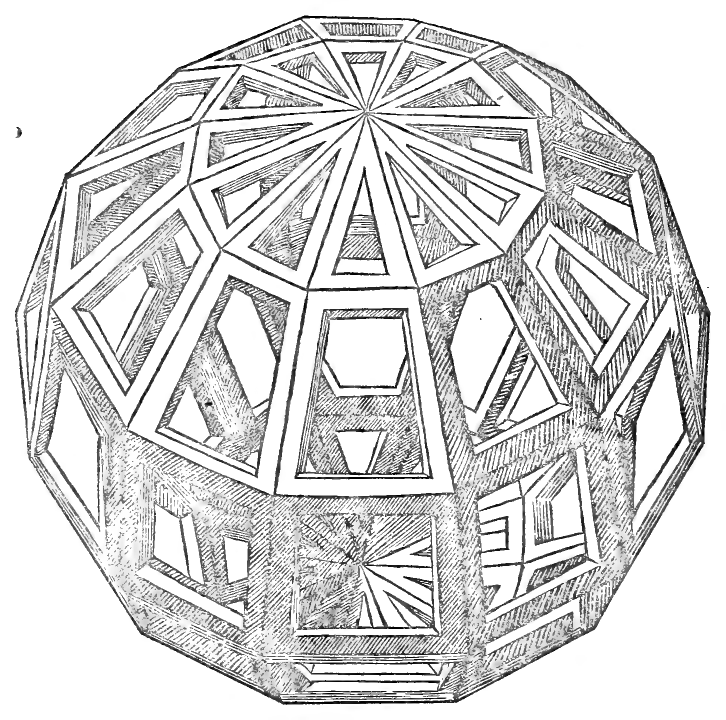

   :term:`*Septuaginta Duarum Basium Vacuum* <septuaginta-duarum-basium>` (:term:`Ἑβδομηκονταδισσάεδρον <septuaginta-duarum-basium>` :term:`κενόν <vacuum>`)

Tabula XLI (Folio 0271) — Columna Laterata Triangula Solida
-----------------------------------------------------------

.. folio:: 0271

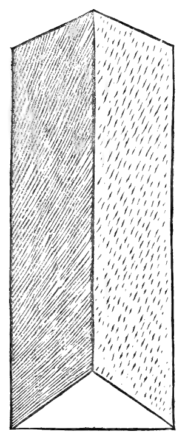

   :term:`*Columna Laterata Triangula Solida* <corpo-seratile>` (:term:`Κίων πλευρώδης τρίγωνος <corpo-seratile>` στερεός)

Tabula XLII (Folio 0273) — Columna Laterata Triangula Vacua
-----------------------------------------------------------

.. folio:: 0273

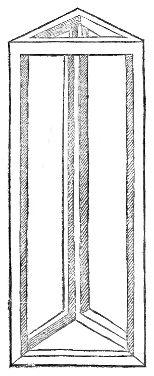

   :term:`*Columna Laterata Triangula Vacua* <corpo-seratile>` (:term:`Κίων πλευρώδης τρίγωνος <corpo-seratile>` κενός)

Tabula XLIII (Folio 0275) — Pyramis Laterata Triangula Solida
-------------------------------------------------------------

.. folio:: 0275

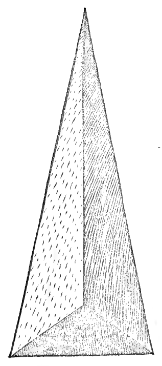

   :term:`*Pyramis Laterata Triangula Solida* <pyramide-triangula>` (:term:`Πυραμὶς πλευρώδης τρίγωνος <pyramide-triangula>` στερεά)

Tabula XLIIII (Folio 0277) — Pyramis Laterata Triangula Vacua
-------------------------------------------------------------

.. folio:: 0277

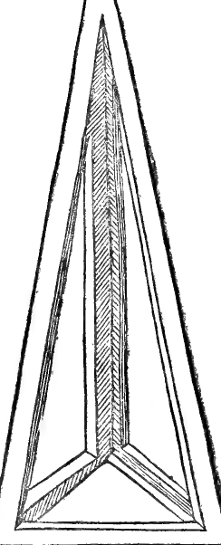

   :term:`*Pyramis Laterata Triangula Vacua* <pyramide-triangula>` (:term:`Πυραμὶς πλευρώδης τρίγωνος <pyramide-triangula>` κενή)

Tabula XLV (Folio 0279) — Columna Laterata Quadrangula Solida
-------------------------------------------------------------

.. folio:: 0279

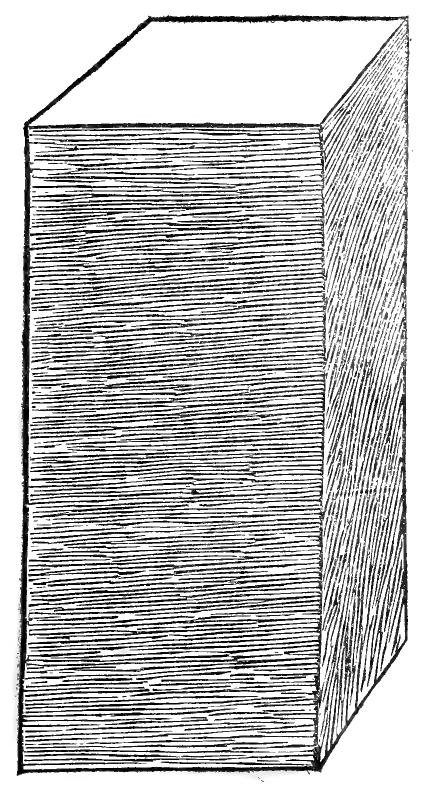

   *Columna Laterata Quadrangula Solida* (Κίων πλευρώδης τετράγωνος στερεός)

Tabula XLVI (Folio 0281) — Columna Laterata Quadrangula Vacua
-------------------------------------------------------------

.. folio:: 0281

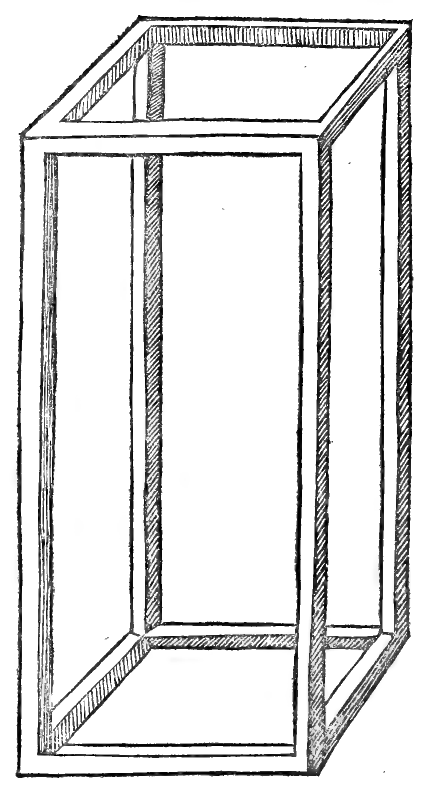

   *Columna Laterata Quadrangula Vacua* (Κίων πλευρώδης τετράγωνος κενός)

Tabula XLVII (Folio 0283) — Pyramis Laterata Quadrangula Solida
---------------------------------------------------------------

.. folio:: 0283

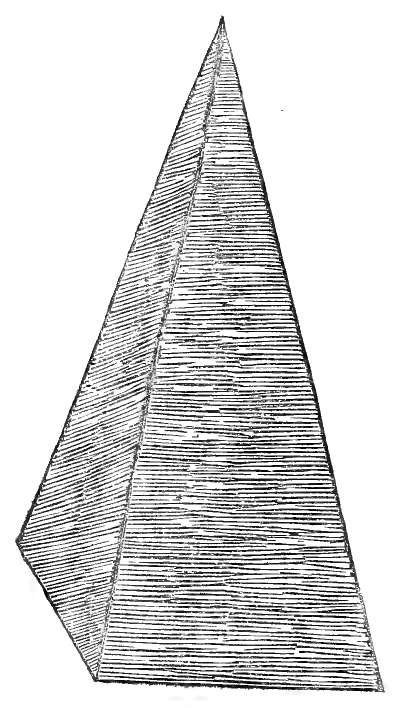

   *Pyramis Laterata Quadrangula Solida* (Πυραμὶς πλευρώδης τετράγωνος στερεά)

Tabula XLVII-bis (Folio 0285) — Pyramis Laterata Quadrangula Solida (bis)
-------------------------------------------------------------------------

.. folio:: 0285

   *Pyramis Laterata Quadrangula Solida (bis)* (Πυραμὶς πλευρώδης τετράγωνος στερεά)

Tabula XLVIII (Folio 0287) — Pyramis Laterata Quadrangula Vacua
---------------------------------------------------------------

.. folio:: 0287

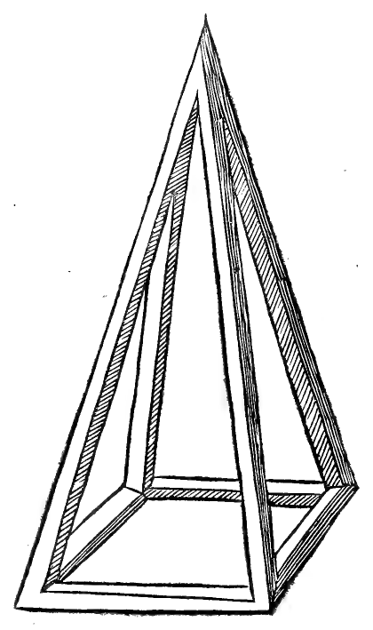

   *Pyramis Laterata Quadrangula Vacua* (Πυραμὶς πλευρώδης τετράγωνος κενή)

Tabula XLIX (Folio 0289) — Columna Laterata Penthagona Solida
-------------------------------------------------------------

.. folio:: 0289

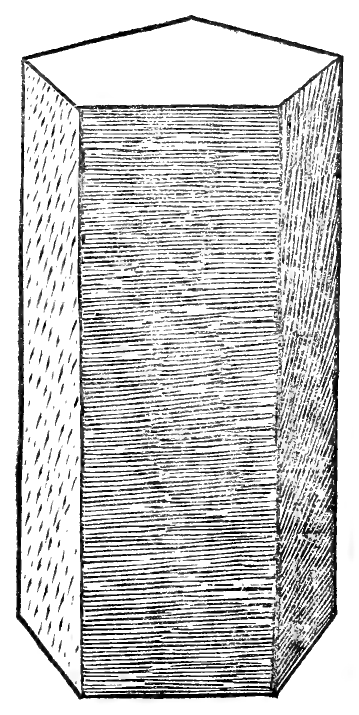

   *Columna Laterata Penthagona Solida* (:term:`Κίων πλευρώδης πεντάγωνος <colonna-pentagona>` στερεός)

Tabula L (Folio 0291) — Columna Laterata Penthagona Vacua
---------------------------------------------------------

.. folio:: 0291

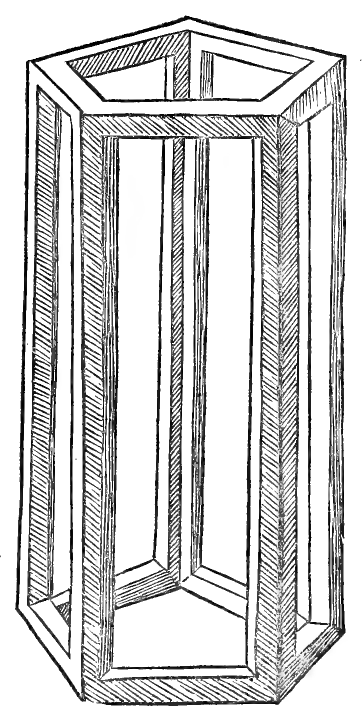

   *Columna Laterata Penthagona Vacua* (:term:`Κίων πλευρώδης πεντάγωνος <colonna-pentagona>` κενός)

Tabula LI (Folio 0293) — Pyramis Laterata Penthagona Solida
-----------------------------------------------------------

.. folio:: 0293

   *Pyramis Laterata Penthagona Solida* (:term:`Πυραμὶς πλευρώδης πεντάγωνος <pyramide-pentagona>` στερεά)

Tabula LII (Folio 0295) — Pyramis Laterata Penthagona Vacua
-----------------------------------------------------------

.. folio:: 0295

   *Pyramis Laterata Penthagona Vacua* (:term:`Πυραμὶς πλευρώδης πεντάγωνος <pyramide-pentagona>` κενή)

Tabula LIII (Folio 0297) — Columna Laterata Exagona Solida
----------------------------------------------------------

.. folio:: 0297

   :term:`*Columna Laterata Exagona Solida* <colonna-exagona>` (:term:`Κίων πλευρώδης ἑξάγωνος <colonna-exagona>` στερεός)

Tabula LIIII (Folio 0299) — Columna Laterata Exagona Vacua
----------------------------------------------------------

.. folio:: 0299

   :term:`*Columna Laterata Exagona Vacua* <colonna-exagona>` (:term:`Κίων πλευρώδης ἑξάγωνος <colonna-exagona>` κενός)

Tabula LV (Folio 0301) — Pyramis Laterata Triangula Inaequilatera Solida
------------------------------------------------------------------------

.. folio:: 0301

   :term:`*Pyramis Laterata Triangula Inaequilatera Solida* <pyramide-triangula>` (:term:`Πυραμὶς πλευρώδης τρίγωνος <pyramide-triangula>` ἀνισόπλευρος στερεά)

Tabula LVI (Folio 0303) — Pyramis Laterata Triangula Inaequilatera Vacua
------------------------------------------------------------------------

.. folio:: 0303

   :term:`*Pyramis Laterata Triangula Inaequilatera Vacua* <pyramide-triangula>` (:term:`Πυραμὶς πλευρώδης τρίγωνος <pyramide-triangula>` ἀνισόπλευρος κενή)

Tabula LVII (Folio 0305) — Columna Rotunda Solida
-------------------------------------------------

.. folio:: 0305

   :term:`*Columna Rotunda Solida* <colonna-rotonda>` (:term:`Κίων στρογγύλος <colonna-rotonda>` στερεός)

Tabula LVIII (Folio 0307) — Pyramis Rotunda Solida
--------------------------------------------------

.. folio:: 0307

   :term:`*Pyramis Rotunda Solida* <pyramide-rotonda>` (:term:`Πυραμὶς στρογγύλη <pyramide-rotonda>` στερεά)

Tabula LIX (printed LXI) (Folio 0309) — Sphera Solida
-----------------------------------------------------

.. folio:: 0309

   *Sphera Solida* (:term:`Σφαῖρα <spera>` στερεά)
