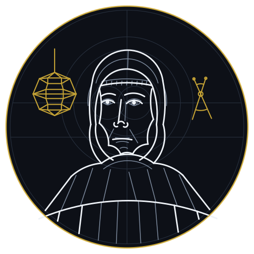

:site_title: Fra Luca Pacioli

.. container:: author-overline

   semantic digital archive • the works of

================
Fra Luca Pacioli
================

:person:`Fra Luca Pacioli <pacioli>` (c. 1447–1517), Franciscan friar, teacher of mathematics, and close collaborator of :person:`Leonardo da Vinci <leonardo>`, bridged ancient Euclidean proportion with Renaissance art, architecture, algebra, and double-entry accounting. This archive preserves his two landmark Venetian treatises—*De Divina Proportione* (1509) and the *Summa de Arithmetica* (1494)—across synchronized multilingual tracks, folio-cropped woodcuts, calibrated vector figures, and exact symbolic demonstrations.

Works in This Archive
---------------------

.. container:: home-book-hero

   .. container:: home-book-thumb plate-light

      .. image:: de_divina_proportione/plates/polyhedra/plate_23/0235.g1.png
         :alt: Solid Truncated Icosahedron woodcut by Leonardo da Vinci (1509)
         :target: de_divina_proportione/index.html

   .. container:: home-book-body

      .. rubric:: Venetian First Edition · 1509 · 71 Chapters · 60 Leonardo Woodcut Plates

      **On the Divine Proportion (*De Divina Proportione*)** — Explores the golden ratio and its "thirteen marvelous effects" from Euclid's Book XIII, Vitruvian architectural proportion, the geometric Roman alphabet, and sixty Platonic and Archimedean solids drawn in perspective by Leonardo da Vinci.

      .. container:: home-actions

         * :doc:`Open De Divina Proportione → <de_divina_proportione/index>`
         * :doc:`Compendio (Chs. 1–71) → <de_divina_proportione/compendio/index>`
         * :doc:`Leonardo's 60 Polyhedra → <de_divina_proportione/plates/polyhedra/index>`

.. container:: home-book-hero

   .. container:: home-book-thumb

      .. image:: summa_1494/dist_01_dedication_arithmetica/fig_01_figurate_perfect.svg
         :alt: Figurate and perfect number geometry from Pacioli's Summa (1494)
         :target: summa_1494/index.html

   .. container:: home-book-body

      .. rubric:: Venetian First Edition · 1494 · 5 Distinctions

      **Summary of Arithmetic, Geometry, Proportions and Proportionality (*Summa de Arithmetica*)** — The first printed encyclopedia of Renaissance mathematics, uniting speculative arithmetic, Cossic algebra, Euclidean proportion theory, practical geometry, and the celebrated treatise on Venetian double-entry bookkeeping.

      .. container:: home-actions

         * :doc:`Open the Summa (1494) → <summa_1494/index>`
         * :doc:`Distinction I (Arithmetic) → <summa_1494/dist_01_dedication_arithmetica/dist_01_dedication_arithmetica_en>`
         * :doc:`Double-Entry Bookkeeping → <summa_1494/dist_04_computis_quaderno/dist_04_computis_quaderno_en>`

Key Features
------------

.. container:: home-feature-grid

   .. container:: home-feature-card

      **Multilingual Synchronized Codices**

      Read *De Divina Proportione* across synchronized English, original 1509 Venetian Italian, and Constantin Winterberg's 1889 German edition alongside archival folios.

   .. container:: home-feature-card

      **Woodcuts & Calibrated Vector Diagrams**

      Inspect cropped 1509 Venetian woodcuts—including Leonardo's sixty polyhedral plates, Vitruvian diagrams, and the Roman capital alphabet—paired with interactive SVGs.

   .. container:: home-feature-card

      **Exact SymPy Proportions & Bookkeeping**

      Verify golden-section polyhedra, Boethian proportions, and Venetian ledger conservation laws symbolically in :doc:`Symbolic Demos <demos/index>`.

Reference & Project
-------------------

.. container:: home-columns

   .. container:: home-col

      .. rubric:: Scholarly Apparatus

      * :doc:`People <people/index>` — Pacioli, Leonardo da Vinci, Piero della Francesca, Euclid, Boethius, and Winterberg
      * :doc:`Bibliography <bibliography>` — 1494 and 1509 Venetian prints and modern critical editions
      * :doc:`Divine Proportion Glossary <de_divina_proportione/glossary>` & :doc:`Summa Glossary <summa_1494/glossary>` — Renaissance Italian, Latin, and Greek terms

   .. container:: home-col

      .. rubric:: About This Project

      * :doc:`About <about/index>` — Scope, folio provenance, and connection to GEOMETOR
      * :doc:`Using This Edition <usage/index>` — Reading guide, track switching, and diagram controls
      * :doc:`Demos <demos/index>`, :doc:`Log <log/index>`, & :doc:`Modules <modules/index>` — Symbolic demos, journal, and API reference

.. toctree::
   :hidden:
   :maxdepth: 2

   de_divina_proportione/index
   summa_1494/index
   people/index
   bibliography
   about/index
   usage/index
   demos/index
   log/index
   modules/index
