:layout: book

.. _plates-alphabet-de:

Anhang I: Das Geometrische Römische Alphabet (Deutsch — 1889)
=============================================================

.. container:: track-nav

   :ref:`English <plates-alphabet-en>` · :ref:`Italiano (1509) <plates-alphabet-it>` · **Deutsch (1889)** | :ref:`← Plates Index <plates-index>`

Lettera A (Folio 0139)
----------------------

.. folio:: 0139

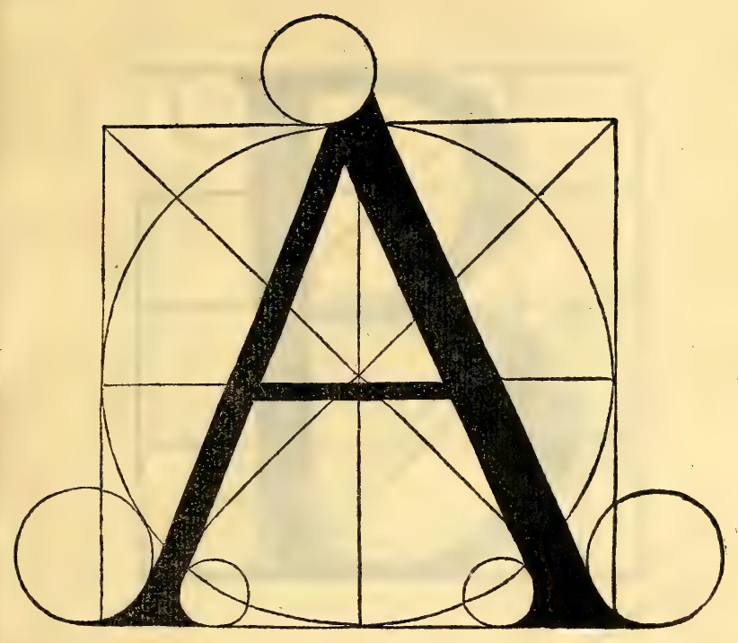

   Lettera A (Folio 0139)

Dieser Buchstabe A wird aus dem Kreise und seinem Quadrat entnommen. Das Bein zur Rechten muss einen der neun Theile der Höhe dick sein. Das linke Bein muss halb so dick sein als das dicke. Das mittlere (Quer-) Bein muss den dritten Theil des dicken Beines dick sein. Die Breite besagten Buchstabens bestimmt jedes Bein mittelst des Kreuzungspunktes der Diagonalen. Das mittlere liegt ein wenig tiefer, wie du hier mittelst der vorgezeichneten Durchmesser ersiehst.

Lettera B (Folio 0141)
----------------------

.. folio:: 0141

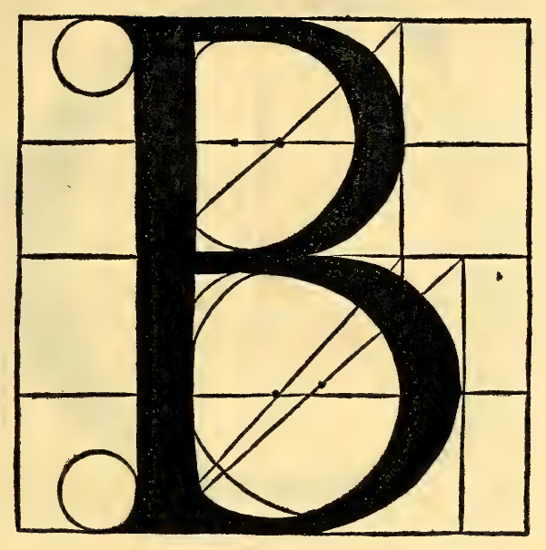

   Lettera B (Folio 0141)

Dieser Buchstabe B setzt sich aus zwei Kreisen zusammen und der untere ist der grössere: nämlich von den neun Theilen der Gesammthöhe muss er fünf zum Durchmesser haben, und der obere vier Neuntel, wie es sich dir hier oben im rechten Verhältniss den Augen darstellt.

Lettera C (Folio 0143)
----------------------

.. folio:: 0143

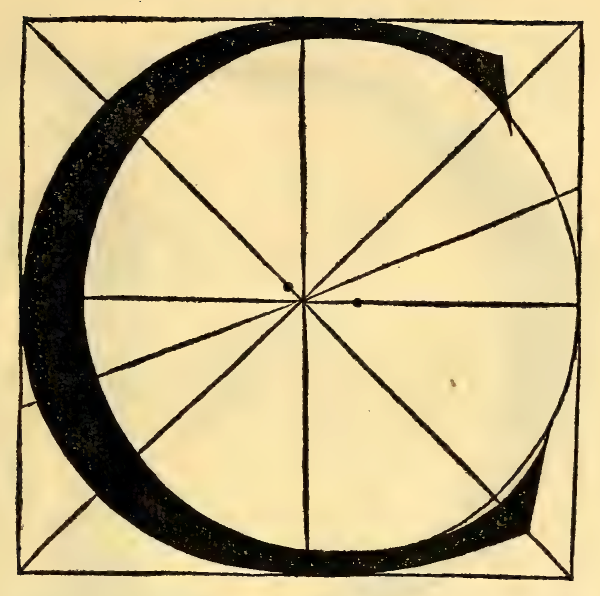

   Lettera C (Folio 0143)

Dieser Buchstabe C wird aus dem Kreise und seinem Quadrat entnommen, indem man den vierten Theil des Kreisbogens von aussen und innen her verdickt. Der Kopf oben endigt über dem Durchschnitt des Durchmessers und Kreisumfanges, der unten überschreitet den Kreuzungspunkt um ein halbes Neuntel nahe der Ecke des Quadrates, wie es in der Figur erhellt, und ergibt sich auf dieselbe Art wie ein O.

Lettera D (Folio 0145)
----------------------

.. folio:: 0145

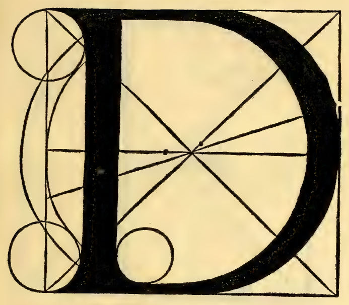

   Lettera D (Folio 0145)

Dieser Buchstabe D wird aus dem Kreise und Quadrate entnommen. Das geradlinige Bein muss zwischen den Kreuzpunkten von Kreis und Diagonalen einen der neun Theile dick sein. Der runde Körper verdickt sich wie bei anderen Krümmungen. Das Verbindungsglied oben muss ein Drittel des dicken Beines dick sein, und das unten ein Viertel oder ein Drittel.

Lettera E (Folio 0147)
----------------------

.. folio:: 0147

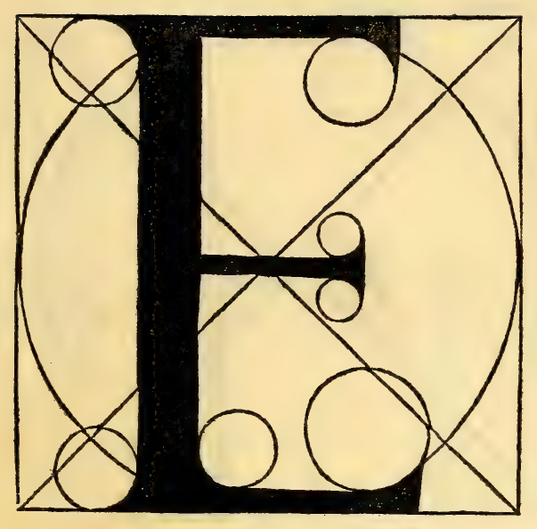

   Lettera E (Folio 0147)

Dieser Buchstabe E leitet sich aus dem Kreise und seinem Vierseit her. Das dicke Bein muss einen der neun Theile, das obere die Hälfte des dicken Beines stark sein, das untere gleicherweise; das mittlere den dritten Theil des dicken Beines, wie das mittlere des A, und besagter Buchstabe muss so breit sein wie die halbe Seite seines Vierecks, und so wird er am vollkommensten sein.

Lettera F (Folio 0149)
----------------------

.. folio:: 0149

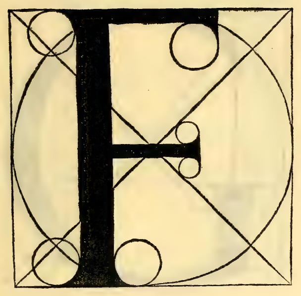

   Lettera F (Folio 0149)

Dieser Buchstabe F bildet sich auf die Art wie der Buchstabe E, weder mehr noch weniger, ausgenommen dass F ohne das dritte Bein ist, wie du es deutlich am Ort besagten E vor Augen gehabt hast mit allen seinen Proportionen. Darum möge hier dieses dir genügen.

Lettera G (Folio 0151)
----------------------

.. folio:: 0151

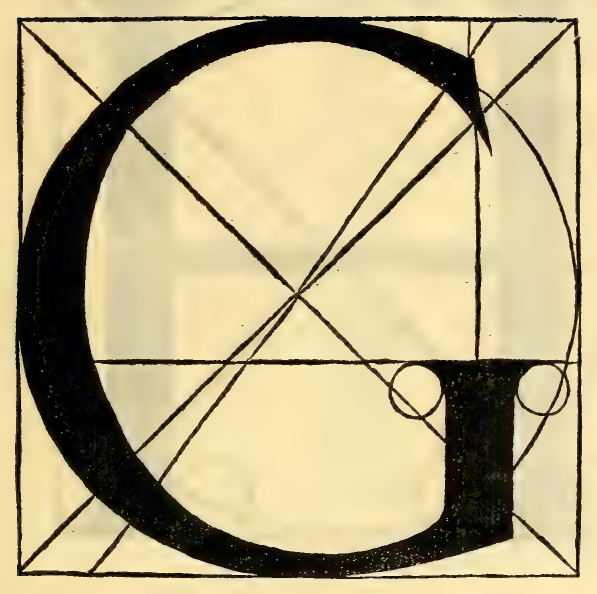

   Lettera G (Folio 0151)

Dieser Buchstabe G bildet sich wie das C aus seinem Kreise und Vierseit. Das untere gerade Bein muss ein Drittel seiner Quadratseite hoch und einen der neun Theile der Höhe seines Quadrats dick sein.

Lettera H (Folio 0153)
----------------------

.. folio:: 0153

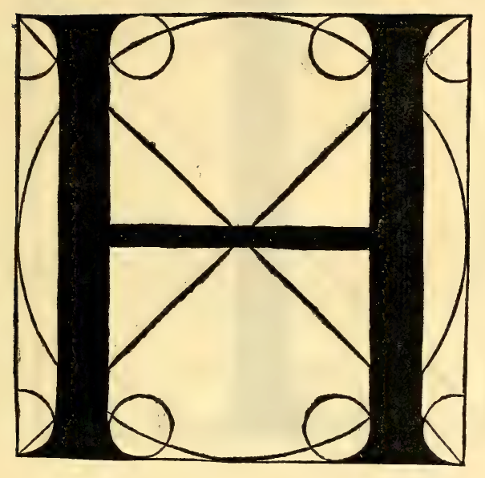

   Lettera H (Folio 0153)

Dieser Buchstabe H wird aus dem Kreise und seinem Vierseit abgeleitet. Seine dicken Beine werden mittelst der Kreuzungspunkte gemacht, d. h. wo die Peripherie des Kreises und die Diagonalen des Quadrats sich schneiden. Die Dicke besagter Beine muss einen der neun Theile der Höhe betragen, und das mittlere wird mittelst des Durchmessers gemacht. Seine Dicke muss den dritten Theil des dicken Beines betragen, wie der Querbalken des A.

Lettera I / J (Folio 0155)
--------------------------

.. folio:: 0155

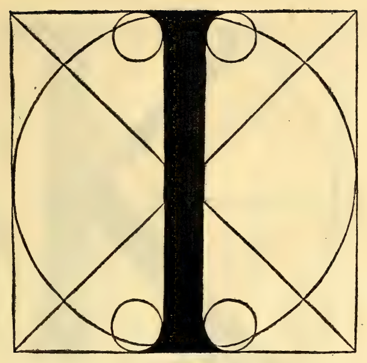

   Lettera I / J (Folio 0155)

Dieser Buchstabe I (J) wird aus dem Kreise und Vierseit entnommen. Seine Dicke muss einen von den neun Theilen betragen, so dass seine Bildung vor den übrigen leicht ist.

Lettera K (Folio 0157)
----------------------

.. folio:: 0157

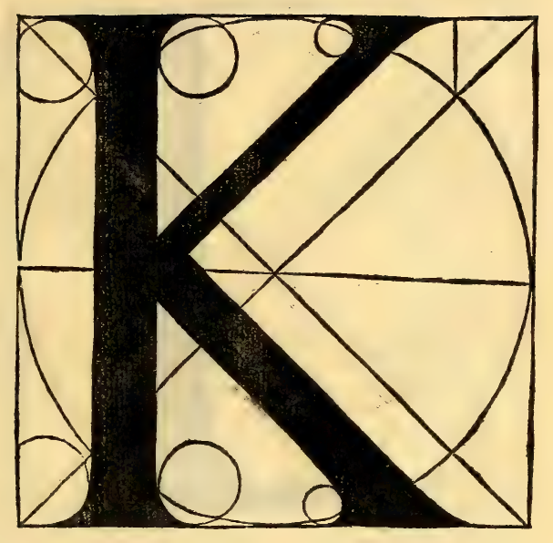

   Lettera K (Folio 0157)

Dieser Buchstabe K wird aus dem Kreise und seinem Vierseit entnommen, indem man eine Linie als Durchmesser des Vierseits zieht. In dieser Linie beschliessen und beendigen sich die beiden Beine in der Mitte des dicken Beines. Das untere Bein muss wie die übrigen Beine einen der neun Theile dick sein; das obere die Hälfte des dicken, wie das linke des A. Das untere muss bis zum Kreuzungspunkt oder darüber hinaus lang sein; das obere bleibt innerhalb des Kreuzungspunktes.

Lettera L (Folio 0159)
----------------------

.. folio:: 0159

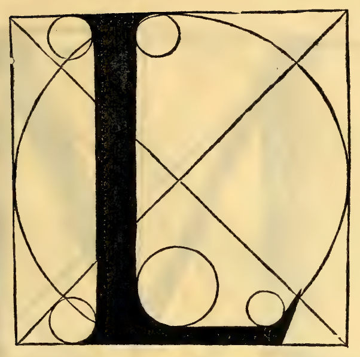

   Lettera L (Folio 0159)

Dieser Buchstabe L wird aus dem Kreise und seinem Vierseit entnommen. Seine Dicke muss einen der neun Theile der Höhe betragen. Seine Breite die Hälfte der Quadratseite mit den darüber beschriebenen Rundungen. Das dünne Bein muss unten halb so dick sein wie das dicke, wie das des E und des F.

Lettera M (Folio 0161)
----------------------

.. folio:: 0161

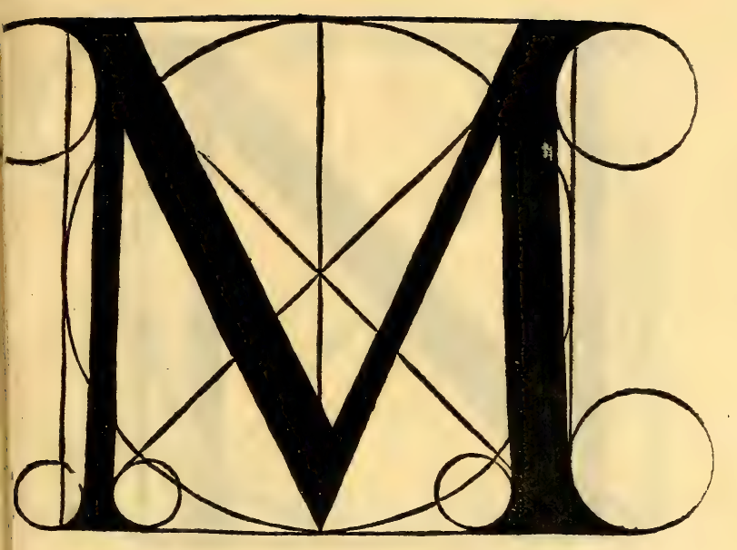

   Lettera M (Folio 0161)

Dieser Buchstabe M wird aus dem Kreise und seinem Quadrat entnommen. Die dünnen Beine müssen halb so dick sein wie die dicken, wie das linke des A. Die äusseren Beine müssen ein wenig einwärts in das Quadrat treten; die mittleren liegen zwischen jenen und den Durchschnitten der Durchmesser. Ihre Dicken, dickere und dünnere, verhalten sich wie die des A, wie du aus der Figur deutlich verstehen kannst.

Lettera N (Folio 0163)
----------------------

.. folio:: 0163

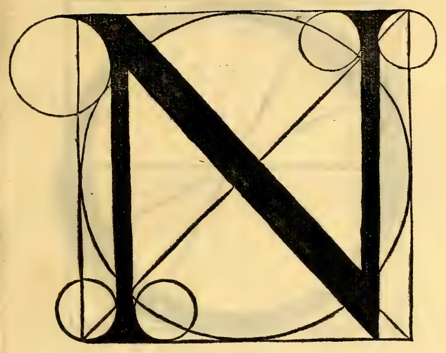

   Lettera N (Folio 0163)

Dieser Buchstabe N wird aus seinem Kreise und aus dem Quadrat entnommen. Das erste Bein muss ausserhalb des Durchschnittes der Durchmesser liegen. Das mittlere Querbein muss einen der neun Theile, diametral genommen, dick sein. Das dritte Bein muss ausserhalb des Kreuzungspunktes liegen. Erstes und letztes Bein müssen halb so dick sein wie das dicke Bein, nämlich eine halbe Kopflänge (1/18 der Quadratseite).

Lettera O (primo modo perfectissimo) (Folio 0165)
-------------------------------------------------

.. folio:: 0165

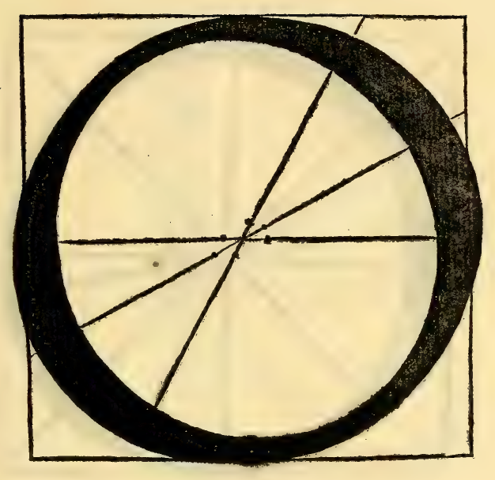

   Lettera O (primo modo perfectissimo) (Folio 0165)

Dieses O ist sehr vollkommen.

Lettera O (secondo modo) (Folio 0167)
-------------------------------------

.. folio:: 0167

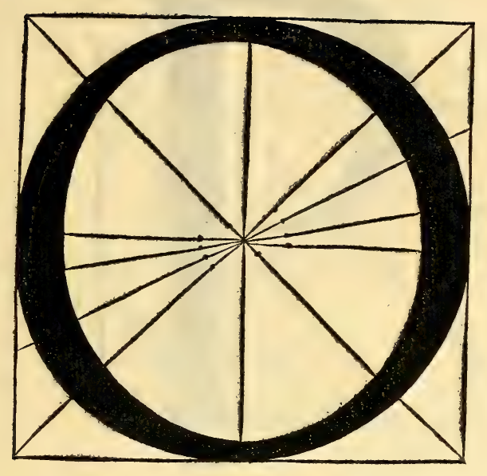

   Lettera O (secondo modo) (Folio 0167)

Dieser Buchstabe O wird aus dem Kreise und seinem Quadrat entnommen. Es wird in vier Theile getheilt, d. h. kreuzweise mittelst der vier Mittellinien. Sein Körper muss einen der neun Theile dick sein, und sein Körper muss oben halb so dick sein als sein dicker Theil. Von seinen Bäuchen muss einer aufwärts, der andere abwärts hängen. Der dünne Theil des Körpers muss ein Drittel seines Bauches dick sein. Und weil darüber zwei Meinungen herrschen, so habe ich dir noch einen anderen hingesetzt, der nach meinem Gefallen sehr vollkommen ist, und du nimmst, welcher dir gut dünkt, und wirst aus ihnen das Q bilden.

Lettera P (Folio 0169)
----------------------

.. folio:: 0169

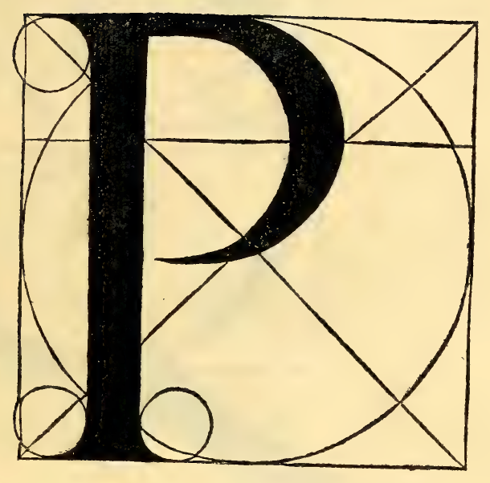

   Lettera P (Folio 0169)

Dieser Buchstabe P wird aus dem Kreise und seinem Vierseit entnommen. Sein dickes Bein muss einen der neun Theile betragen. Die Form des Runden muss so gross sein wie der untere des B und die Dicke des Bauches muss so gross sein wie das dicke Bein, und besagter Buchstabe muss an den Kreuzungspunkten des grossen Kreises beginnen, und so wird er sehr vollkommen sein.

Lettera Q (Folio 0171)
----------------------

.. folio:: 0171

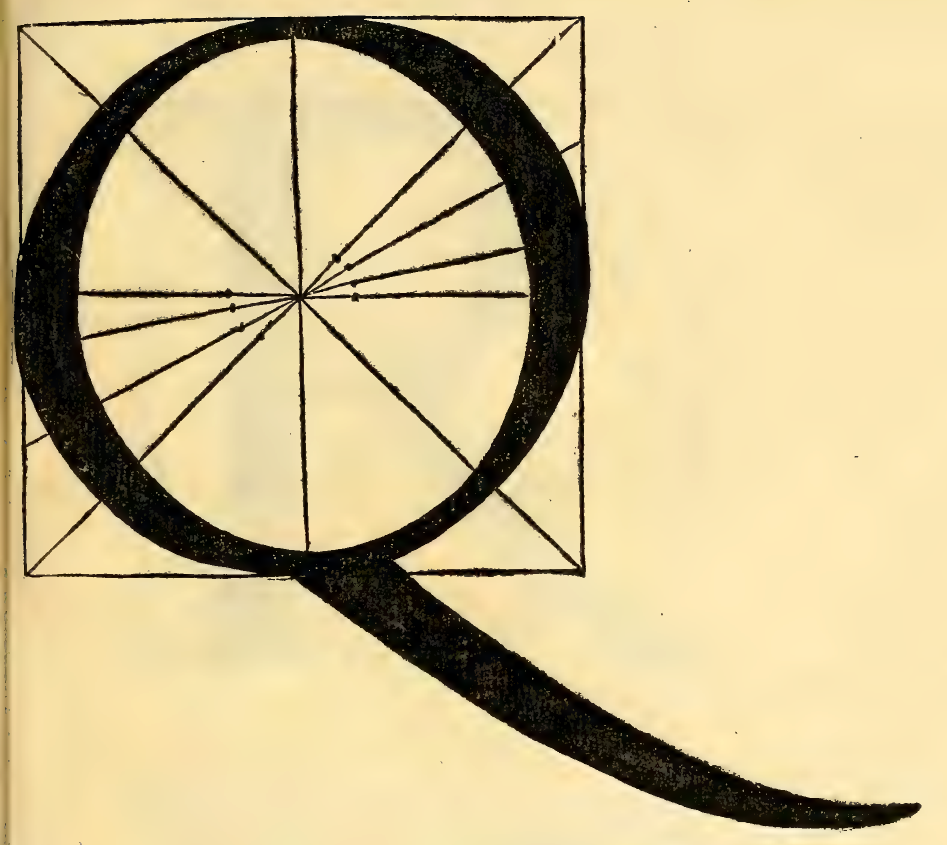

   Lettera Q (Folio 0171)

Dieser Buchstabe Q wird, wie ich oben sagte, aus dem O entnommen, indem sein Bein drei Kopflängen seiner Höhe unterhalb des Quadrats, d. h. drei von den neun Theilen seiner Quadratseite oder Durchmesser seines Kreises endet, wie es hier im rechten Verhältniss erscheint, indem man die dicken Bäuche und seine dünnen entgegengesetzten genau wie beim O gesagt worden führt. Und sein Bein muss neun Kopflängen, d. h. so lang wie sein rechtwinkeliges Vierseit sein, und das Ende muss am obersten Punkte ein Neuntel der Höhe hoch sein, indem man der Krümmung der Feder mit der Abnahme seiner Dicke folgt.

Lettera R (Folio 0173)
----------------------

.. folio:: 0173

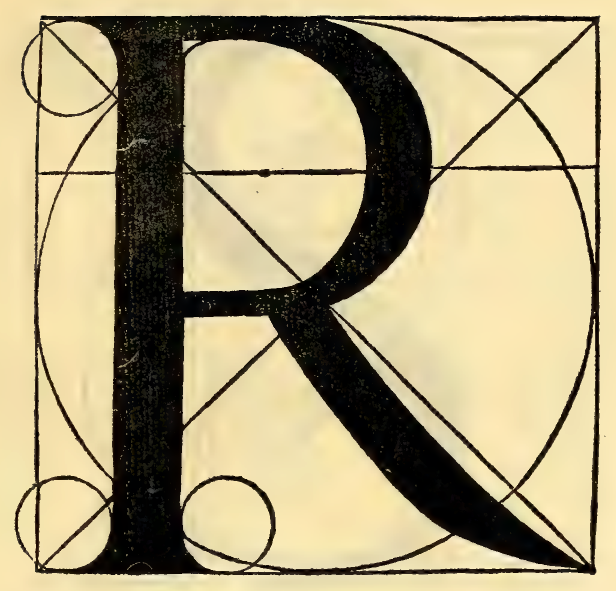

   Lettera R (Folio 0173)

Dieser Buchstabe R wird aus dem Buchstaben B abgeleitet. Seine Rundung geht um eine halbe Beindicke unterhalb des Centrums. Dieser ganze Buchstabe muss innerhalb der Kreuzungspunkte liegen, ausgenommen das gebogene Bein, welches über die Kreuzpunkte hinaus bis ans Ende des Vierseits gehen muss. Besagtes gebogenes Bein muss einen der neun Theile dick sein, indem es dünn in eine Spitze am Ende des Vierseits nach Art von krummen Linien ausläuft.

Lettera S (Folio 0175)
----------------------

.. folio:: 0175

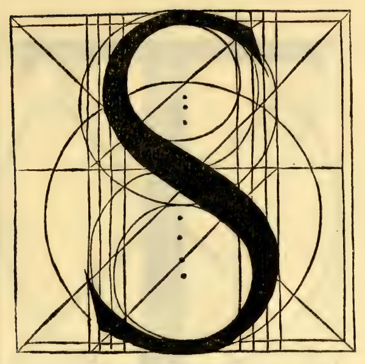

   Lettera S (Folio 0175)

Dieser Buchstabe S wird aus acht Kreisen entnommen und dieses ist sein Bildungsgesetz, wie hier im Beispiel erhellt. Nachdem du von diesen Kreisen mittelst ihrer Parallelen ihre Centra aufgefunden, so wirst du finden, dass die unteren um ein Drittel des Neuntels seines Quadrats grösser seien als die oberen. Der Bauch in der Mitte muss genau den neunten Theil der Höhe dick sein. Die dünneren Theile ein Drittel der Dicke, indem die Köpfe in anmuthiger Form endigen.

Lettera T (Folio 0177)
----------------------

.. folio:: 0177

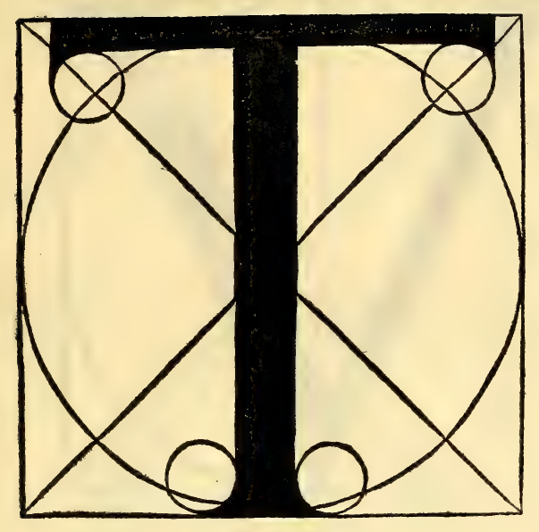

   Lettera T (Folio 0177)

Dieser Buchstabe T wird aus dem Quadrat und Kreise entnommen. Das dicke Bein muss genau so sein, wie beim I gesagt worden. Das Querbein muss halb so dick sein wie das dicke, wie das obere beim E und F, und muss um eine halbe Kopflänge beiderseits von den Ecken seiner Quadratseite enden, und wird beim Anblick sehr anmuthig.

Lettera V (Folio 0179)
----------------------

.. folio:: 0179

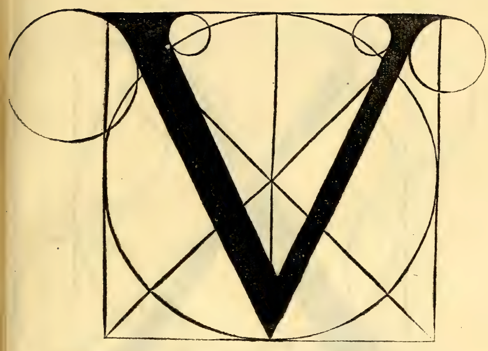

   Lettera V (Folio 0179)

Dieser Buchstabe V wird aus seinem ganzen vollen Quadrat entnommen. Das linke Bein muss den neunten Theil seines Quadrats, diametral genommen, dick sein, wie das rechte des A und quere des N. Das rechte halb so dick als das dicke, ebenfalls diametral genommen wie das linke des A, und endigt in einem Punkte in der Basis des Quadrates am Ende des Kreisdurchmessers.

Lettera X (Folio 0181)
----------------------

.. folio:: 0181

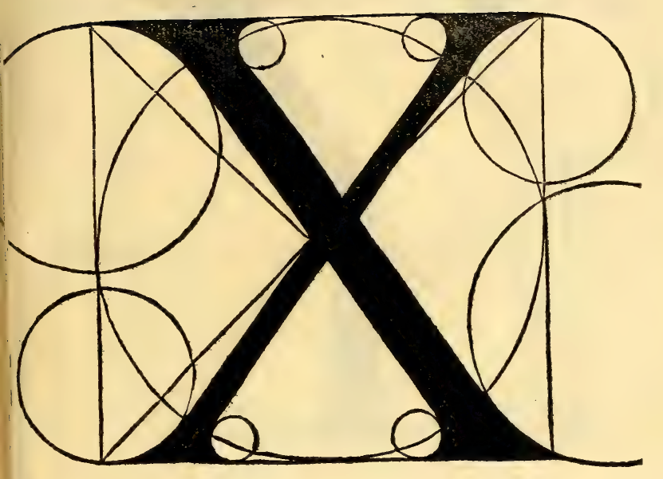

   Lettera X (Folio 0181)

Dieser Buchstabe X bedarf seines ganzen Quadrats, indem sich seine Beine im Durchschnitt der Durchmesser kreuzen. Und das eine muss den neunten Theil der Höhe dick sein, das andere die Hälfte davon, beide diametral genommen, indem seine Beine mit erforderlicher Anmuth gemäss dem Zwange der kleinen Kreise endigen.

Lettera Y (Folio 0183)
----------------------

.. folio:: 0183

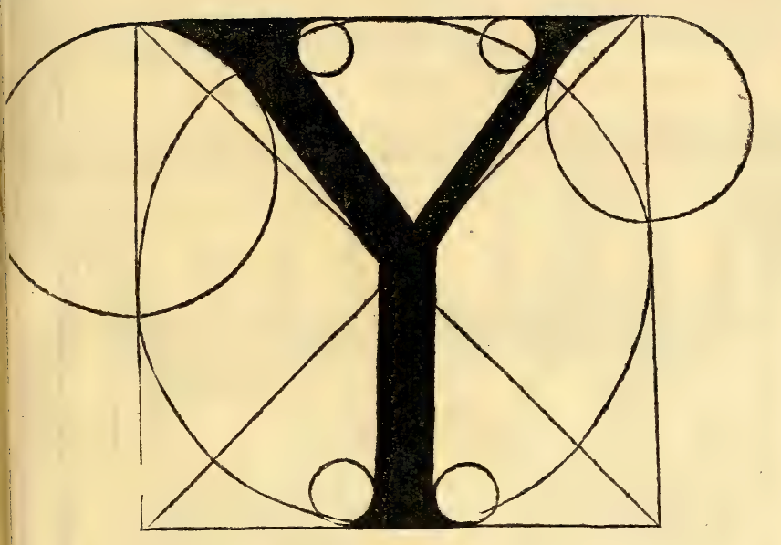

   Lettera Y (Folio 0183)

Dieser Buchstabe Y erfordert das ganze Quadrat. Das rechte und linke Bein müssen so dick sein wie das Verhältniss derer des V aufweist, abgesehen dass sie genau im Durchschnitt der Durchmesser endigen. Und von da nach unten zieht man von ihrer Verbindung bis zur Basis eine ein Neuntel der Quadratseite dicke Linie. Die Spitzen oben endigen auf ihren Kreisen, wie du siehst.
