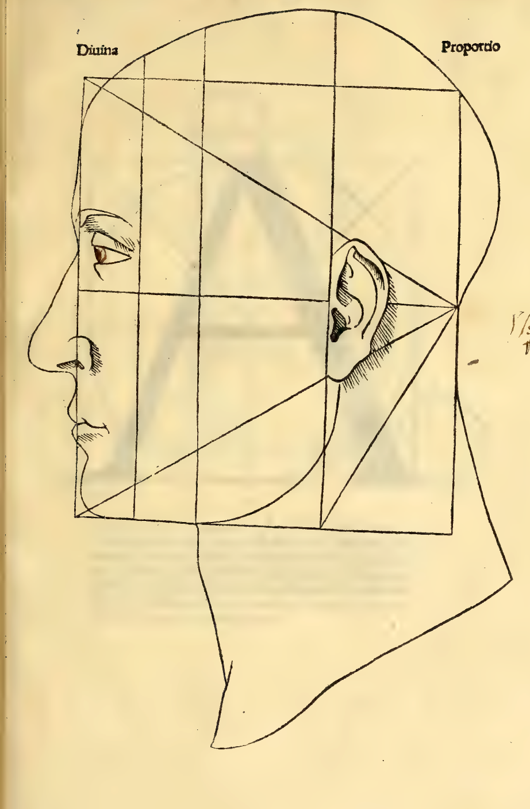
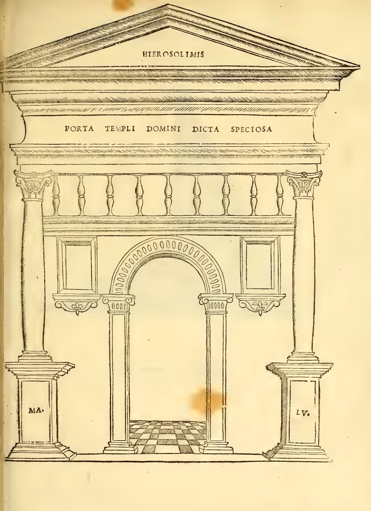
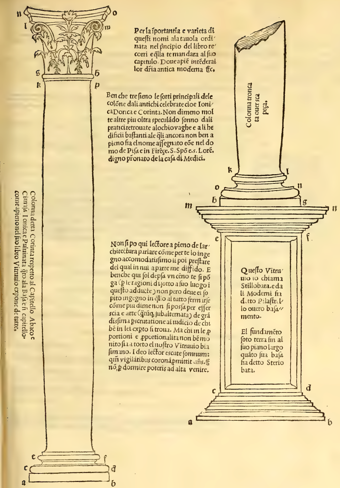
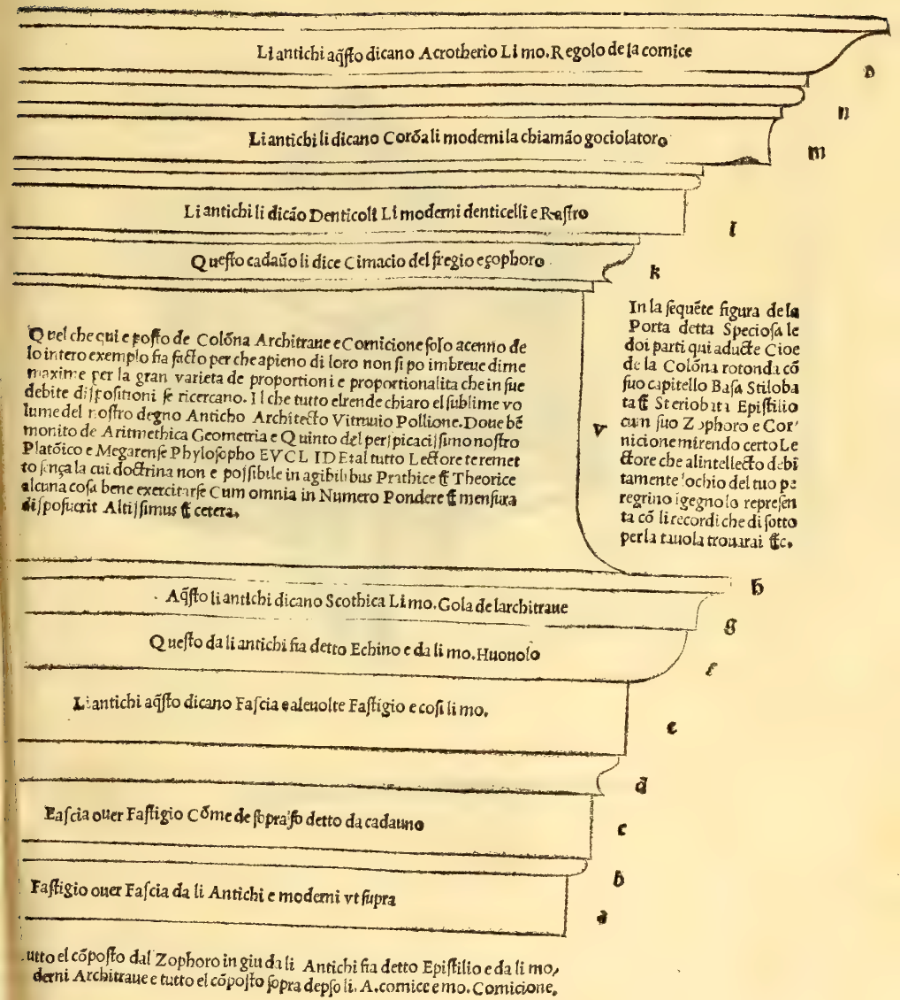
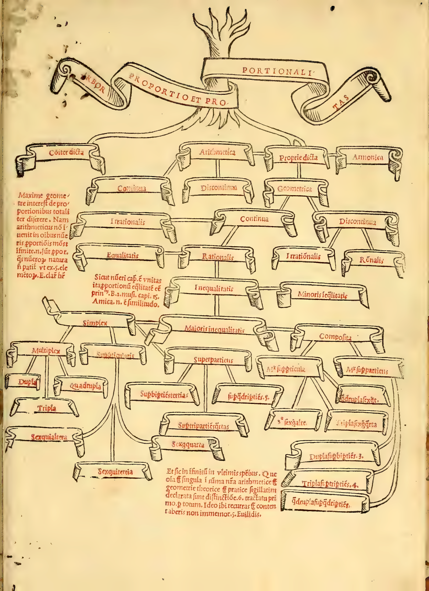

:layout: book

.. _plates-architectural-en:

Architectural Plates and Arbor Proportionis (English)
=====================================================

.. container:: track-nav

   :ref:`English <plates-architectural-en>` · :ref:`Italiano (1509) <plates-architectural-it>` · :ref:`Deutsch (1889) <plates-architectural-de>` | :ref:`← Plates Index <plates-index>`

Folio 0137: Divina Proportio — Caput Humanum (Proportional Profile of the Human Head)
-------------------------------------------------------------------------------------

.. folio:: 0137

   Divina Proportio — Caput Humanum (Proportional Profile of the Human Head)

Divina Proportio: Proportional profile of the human head inscribed in the equilateral triangle and square grid (Tractato de l'Architectura, Cap. I–II).

Folio 0185: Porta Templi Domini Dicta Speciosa
----------------------------------------------

.. folio:: 0185

   :term:`Porta Templi Domini Dicta Speciosa <porta-speciosa>`

:term:`PORTA TEMPLI DOMINI DICTA SPECIOSA <porta-speciosa>` (The Gate of the Lord's Temple Called Beautiful): In the present figure of the gate called Speciosa, the two parts adduced here—namely the round column with its capital, base, :term:`stylobate <stilobata>`, and :term:`stereobate <steriobata>`, and the epistyle with its frieze (zophorus) and cornice—are duly presented to your discerning eye.

Folio 0213: Colonna Corinta, Jonica e Pulvinata con Stilobata e Steriobata
--------------------------------------------------------------------------

.. folio:: 0213

   Colonna Corinta, Jonica e :term:`Pulvinata <pulvinata>` con :term:`Stilobata <stilobata>` e :term:`Steriobata <steriobata>`

Corinthian, Ionic, and Pulvinated Column with :term:`Stylobate <stilobata>` (Pedestal) and :term:`Stereobate <steriobata>`: Column called Corinthian with respect to its capital, abacus, and cymatium, and Ionic and pulvinated with respect to its base and capital, as :person:`Vitruvius <vitruvius>` explains in full, alongside modern columns in the Cathedral of Pisa and in Santo Spirito and San Lorenzo in Florence under the patronage of the House of Medici.

Folio 0215: Epistilio (Architrave), Zophoro (Fregio) e Cornicione
-----------------------------------------------------------------

.. folio:: 0215

   :term:`Epistilio <epistilio>` (:term:`Architrave <epistilio>`), :term:`Zophoro <zophoro>` (:term:`Fregio <zophoro>`) e :term:`Cornicione <cornicione>`

Epistyle (:term:`Architrave <epistilio>`), Zophorus (Frieze), and Cornice: The entire assembly below the frieze is called Epistylium by the Ancients and :term:`Architrave <epistilio>` by the Moderns, and the assembly above it is called Cornice (with lettered mouldings a, c, e = Fascia; f = Echinus/Ovolo; g = Scotia/Gola; k = Cymatium; l = Dentils; m = Corona/Dripstone; o = Acroterium/Reglet).

Folio 0311: Arbor Proportio et Proportionalitas
-----------------------------------------------

.. folio:: 0311

   :term:`Arbor Proportio et Proportionalitas <arbor-proportionis>`

:term:`ARBOR PROPORTIO ET PROPORTIONALITAS <arbor-proportionis>` (Tree of Ratio and Proportionality): Above all it pertains to the geometer to treat completely of proportions; for the arithmetician does not find the measure of ratio in all numbers, since there are infinitely many ratios which the nature of numbers does not admit, as is clear from Book V of :person:`Euclid <euclid>`'s Elements. Just as unity is the head of number, so equality is the principle of proportions (:person:`Boethius <boethius>`, De institutione musica II, c. 15).
